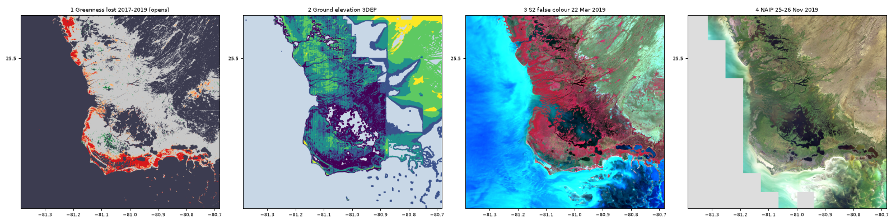
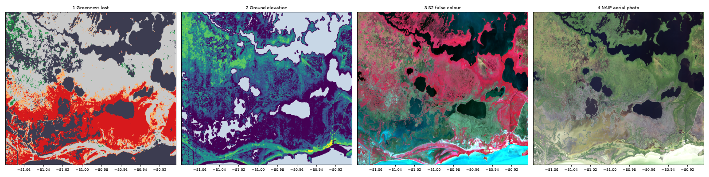
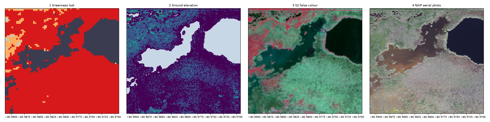

# Everglades mangroves after Hurricane Irma, 2017-2019

Studio project: not created yet. Title "Exp - Everglades mangroves after Hurricane Irma 2017"; Studio derives
the project id from the title, so Save should create
`https://studio.mpc.ds.io/editor/exp-everglades-mangroves-after-hurricane-irma-2017` (no other scenario in
this repo uses this title; check "My projects" before saving).
Files: `studio_script.py` (the code pasted in Studio), `seed.js` (seeds the Studio editor with it),
`run_config.json` (the editor settings used for local tests).

> **Presenting this scenario?** Follow the [presenter notes](presenter-notes.md): the layer to open
> with, then what to show and what to say at each step (2-3 minutes).

## Irma, the storm surge and the forest that drowned

Hurricane Irma crossed south Florida in September 2017. Lagomasino et al. (2021) mapped what it did to the
mangroves of southwest Florida with airborne lidar flown before and after the storm and Landsat time series.
The wind broke the canopy, but most forests came back fast: "Mangroves on well-drained sites (83%) resprouted
new leaves within one year after the storm." Elsewhere the forest did not come back: "By contrast, in
poorly-drained inland sites, we detected one of the largest mangrove diebacks on record (10,760 ha), triggered
by Irma." The cause was the water, not the wind: "the combination of low elevation (median = 9.4 cm asl),
storm surge water levels (>1.4 m above the ground surface), and hydrologic isolation drove coastal forest
vulnerability and were independent of tree height or wind exposure."

This scenario covers the southern tip of the peninsula: "The largest mangrove die-off region occurred along the
southern tip of Florida in a location that is separated from the ocean by the Buttonwood Ridge, a natural
coastal barrier/depositional berm (~0.5 m asl in height) that limits tidal exchange, impounds water, and
isolates inland mangroves from the direct hydrological exchange with Florida Bay". The surge "overtopped the
Buttonwood Ridge, a relatively high natural coastal barrier" and stayed trapped behind it (Lagomasino et al.
2021). 2017 stood out in the region: Taillie et al. (2020) "observed 30 times more mangrove damage, via a
reduction in the normalized difference vegetation index (NDVI), during 2017 compared to any of the eight
previous hurricane seasons". The climate link is the sea level: "Increasing vulnerability from sea level rise,
hydrologic isolation, or drought lowers the threshold for mangrove dieback events following extreme events,
such as hurricanes" (Lagomasino et al. 2021).

*The four layers over the scenario box at tile zoom 11 (about Studio map zoom 10, the opening view), rendered
on a local copy of the backend (the production commit) against Planetary Computer. Panel 4 is blank in the
west: there is no aerial photo over the open Gulf.*

*The same four layers at tile zoom 13 (about map zoom 12), 81.08-80.90W and 25.13-25.25N, between Cape Sable
and Flamingo: the red block of layer 1 fills the low ground of layer 2 (purple, below 0 m) behind the higher strip
along Florida Bay (green and yellow), and shows as pale grey-green dead forest in layer 3 and grey dead trees
in layer 4.*

*Tile zoom 15 (about map zoom 14) at 80.99-80.97W, 25.16-25.18N: in the aerial photo (panel 4), grey standing
dead trees surround a brown pond, more than two years after the storm; the few green crowns are living trees.
The pond was there before the storm (dark grey, not classed, in panel 1; flat water in panel 2); the dead
forest around it is red in panel 1, below 0 m in panel 2 and pale grey-green in panel 3.*

## The four layers

### 1. Jan-Mar 2017 to Jan-Mar 2019: greenness lost (Landsat 8, opens here)

- **What you see:** a continuous **red** band along the south shore of Cape Sable, from about 81.15W to
  Flamingo (80.9W), a few kilometres wide, and red patches on the west coast north of 25.5N. Red = the
  vegetation index fell by 0.2 or more between the dry season before the storm and the dry season after it;
  **orange** = it fell by 0.1-0.2 (damaged); **light grey** = within 0.1 (little change), most of the
  forest; **green** = greener; **dark grey** = not classed, because the index was below 0.5 in 2017: the sea,
  mud and sand, but also the sparse marsh that covers much of the north-east of the box (light green-cyan in
  layer 3, tan in layer 4). Transparent = no clear Landsat view in one of the two periods (rare).
- **How it is made, for non-specialists:**
  1. *A greenness number.* Leaves absorb red light and reflect near-infrared light strongly. The normalized
     difference vegetation index, NDVI = (near-infrared - red) / (near-infrared + red), is high over a dense,
     healthy canopy and falls towards 0 when leaves die and grey wood, mud and water show through
     (Tucker 1979).
  2. *A clean picture of each season.* Landsat 8 passes every 16 days. For each period (1 Jan-31 Mar 2017
     and the same months of 2019), every pixel takes the **median** of its cloud-free NDVI values (up to 6
     dates in 2017 and 5 in 2019); clouds and their shadows are removed with the quality band delivered with
     the data (Foga et al. 2017). The same months in both years keep the season out of the comparison.
  3. *Before minus after.* NDVI 2017 - NDVI 2019 is the greenness lost; 0.2 or more is coloured red, the
     threshold the study used for dieback.
- **Limits:** the study averaged NDVI over the 15 months after the storm against two pre-storm years; this
  layer compares two three-month windows, so it also flags losses that later recovered and pixels where water
  levels differed between the two dry seasons. Forests are not mapped: "vegetated" means NDVI of at least 0.5
  in 2017, which also includes dense marsh, while sparse marsh falls below 0.5 and is dark grey like the sea,
  so dark grey is not a water map. Over dark water the surface reflectance (after the -0.2 offset) can be
  negative and NDVI then leaves the -1 to 1 range; a 2017 value outside 0.5-1 is not classed, which removes
  the false red and green dots over the open Gulf inside the box (a cluster remains further south-west, around
  81.45W 24.9N, outside the box, visible when zoomed out). The red and orange specks in Florida Bay had a
  vegetation reading in 2017 (NDVI 0.5-0.9; most likely its small mangrove islands), so they are kept.
  Landsat pixels are 30 m.
- **Method:** Lagomasino et al. (2021) built a pre-storm reference from Landsat: "A pre-storm reference was
  calculated as the median value for each reflectance and index band for all cloud-free imagery in the two
  years prior Hurricane Irma, August 31, 2015 through August 31, 2017." Dieback was then "We used anomaly
  values to identify mangrove forests with large decreases in the 15 months after the storm using a threshold
  of 0.2 for the 15-month NDVI average anomaly". This layer applies the same 0.2 to a difference of two
  seasonal medians (our simplification, not the study's product). Han et al. (2018) followed Everglades
  mangroves with Landsat from 1985 to 2017 and found that "these large mangrove die‐off areas gradually
  recovered to prehurricane levels 3–4 years after the passage of major hurricanes." Early 2019, about
  17 months after Irma, is well inside that recovery time.
- **Technical chain:** for each period, `load_collection("landsat-c2-l2", bands=["nir08", "red", "qa_pixel"])`
  filtered on `platform = landsat-8`, `landsat:wrs_path = 015`, `eo:cloud_cover < 50` -> `ndvi` per date ->
  `mask` where `qa_pixel` is not 21824 (clear land) or 21952 (clear water) -> `apply_pixel_selection` median
  -> band renamed `ndvi2017` / `ndvi2019` -> `merge_cubes` into a 2-band cube -> `apply_dimension`: NDVI 2017 -
  NDVI 2019 where NDVI 2017 is between 0.5 and 1, else 10 (not classed) -> `colormap` with five classes.

### 2. Ground elevation (USGS 3DEP, 10 m)

- **What you see:** zoomed in on the red band of layer 1, the ground under it is **dark purple** (below 0 m)
  and **blue** (0-0.2 m), a closed basin, while a **green to yellow** strip (0.5 m to above 1 m) runs along
  the Florida Bay shore between the basin and the sea, as the study describes for the Buttonwood Ridge. Teal
  = 0.2-0.5 m. **Pale blue** = open water (the sea, the bays, ponds).
- **How it is made:** the U.S. Geological Survey 3D Elevation Program (3DEP) seamless elevation model at 1/3
  arc-second (about 10 m), heights in metres above the NAVD88 datum, coloured in five fixed classes. The
  seamless model is stitched together from different sources. Here (our reading of the source metadata of the
  two tiles) it is airborne lidar flown in 2008 over the land west of about 80.88W, which holds the whole
  dieback basin (98 % of the zoomed view in the second figure) but only 48 % of the box. East of 80.88W and
  under Florida Bay and the Gulf, the model comes from older elevation models made from topographic maps of
  1951-1976, plus a coarser model offshore. Lidar elevation models give each water body
  one flat level (hydro-flattening, Heidemann 2012), and the older models do the same: here 0 m for the Gulf
  and -0.26 m, 0.1 m and other constants for bays and ponds. Without care those would read as "low ground",
  so any pixel whose 5 x 5 neighbourhood is flat to the millimetre is shown as water.
- **Our computation** (local render at the opening zoom, about 69 m pixels, inside the box, on lidar ground
  only, water left out, pixels with a 2017 NDVI of 0.5 to 1; heights read in 0.02 m steps): where NDVI fell
  by 0.2 or more (19,411 pixels), the median ground height is 0.00 m and 74 % of the pixels are below 0.2 m;
  where it changed by less than 0.1 (176,835 pixels), 0.20 m and 48 %; where it rose by 0.1 or more (3,217
  pixels), 0.34 m and 27 %. The bigger the loss, the lower the ground. 88 % of the vegetated pixels in the box
  are on lidar ground; the other 12 %, on map-based ground, are left out because their heights are not precise
  enough for these classes.
- **Limits:** NAVD88 0 m is a survey datum, not the local mean sea level, and the study quotes heights "asl";
  compare the classes with each other, not with the study's 9.4 cm. Outside the lidar (east of about 80.88W,
  and east of about 80.95-81.0W in the far north of the box), the map-based model is smoother and has
  straight-edged blocks; its 0.2 m classes are finer than its source can resolve, so read the colours there as
  a rough guide only. A few straight-edged pale blue patches there are flat fills, not water.
- **Method:** "the majority of the dieback, or low resilience areas, occurred where ground elevation was under
  10 cm asl" (Lagomasino et al. 2021). The study used finer elevation: "The 1/9 arc second (~3 m × 3 m)
  products were acquired from NED, and reprojected to Landsat resolution to estimate the proportion of each
  resilience class by soil elevation." Planetary Computer's `3dep-seamless` holds 1/3 arc-second items
  (`gsd` 10, ids ending `-13`) and 1 arc-second items (`gsd` 30, ids ending `-1`) over the same cells; the
  `gsd = 10` filter keeps the finer one.
- **Technical chain:** `load_collection("3dep-seamless", bands=["data"])` filtered on `gsd = 10` (items
  n26w082-13 and n26w081-13) -> `apply_pixel_selection` first -> local variance = 5 x 5 mean of squares -
  square of the 5 x 5 mean (`apply_kernel`, `merge_cubes`) -> +100 where variance < 1e-6 m2 -> `colormap`
  with six classes.

### 3. 22 Mar 2019: false colour (Sentinel-2)

- **What you see:** living forest is **red**, the dead forest of layer 1 is **pale grey-green**, the marshes
  inland are light green-cyan, the deeper water of the bays is **black** and the bright, shallow waters of
  the Gulf and Florida Bay are **cyan**.
- **How it is made:** Sentinel-2B, orbit 54, 16:05 UTC, all four tiles of the box (17RMH, 17RMJ, 17RNH,
  17RNJ) at 0.0-0.9 % cloud. Near-infrared (B08) is shown as red, red (B04) as green and green (B03) as blue,
  at 10 m. Healthy leaves are bright in near-infrared, so living forest turns red; dead trees and mud reflect
  little near-infrared and look grey. Reflectance 0-0.4 (B08) and 0-0.12 (B04, B03) is stretched to 0-255.
  Pixels with no data are hidden.
- **Method:** the visual reading behind the NDVI of layer 1 (same two bands plus green), at three times the
  Landsat resolution. The date is in the dry season, inside the 2019 Landsat window.
- **Technical chain:** `load_collection("sentinel-2-l2a", bands=["B08", "B04", "B03"])`, 16:00-16:10 UTC ->
  `apply_pixel_selection` first -> `mask` where B03 is exactly 0 or -0.1 (no data) -> stretch -> 0-255.

### 4. 25-26 Nov 2019: aerial photo, 0.6 m (NAIP)

- **What you see** (zoom in to map zoom 13 or more): in the dieback basin, a **grey**, speckled canopy of
  standing dead trees around **brown** ponds, next to **green** living forest along the creeks and the shore.
  Deeper open water is dark blue to black.
- **How it is made:** the USDA National Agriculture Imagery Program (NAIP) photos of Florida flown on
  25 Nov 2019 (the 4 photo tiles of the north-west coast) and 26 Nov 2019 (the other 62), red, green and blue
  bands at 0.6 m, stretched from 0-180 to 0-255 because the photos are dark over mangrove forest. The photos
  stop a few kilometres off the coast, so the open Gulf in the west of the box is blank.
- **Zoom:** NAIP comes as small tiles (quarter quadrangles), 66 of them over the box. A map tile touches up
  to 16 of them at tile zoom 11, 9 at zoom 12 and 4 at zoom 13, but up to 37 at zoom 10 and 207 at zoom 8,
  more than the backend reads for one tile (the local backend allows 20 and answers HTTP 400 above that; the
  production limit was not checked here). The layer therefore works from map zoom 10 (the opening view) and
  needs map zoom 13 or more to show single trees; one step further out, only the map tiles with 20 photos or
  fewer render, so it shows a few patches of coast.
- **Method:** a visual check of the satellite layers, not a measurement: the grey crowns in the low basin
  match the study's dieback in poorly drained sites, while the green crowns along the creeks match the
  well-drained forest that "resprouted new leaves within one year".
- **Technical chain:** `load_collection("naip", bands=["red", "green", "blue"])`, 25-26 Nov 2019 ->
  `apply_pixel_selection` first -> stretch 0-180 -> 0-255.

## Choices and limits

- **Box.** W 81.3, S 25.1, E 80.8, N 25.6 (about 50 x 55 km). The research note proposed 81.4-80.85W; about a
  third of it was open Gulf and its eastern edge cut the dieback band at Flamingo, so it moved 0.1 degree
  east.
- **Landsat scenes.** WRS path 16 reaches only the western edge of the box, so only path 15 is used (rows 42
  and 43, which overlap). With the research note's "cloud < 10 %" filter each period had only 2-3 scenes and
  large holes after cloud masking. Scenes up to 50 % cloud plus the per-pixel quality mask give 10 scenes on
  6 dates in 2017 (10 Jan, 26 Jan, 11 Feb, 27 Feb, 15 Mar, 31 Mar; 10 Jan from row 42 only and 31 Mar from
  row 43 only, so not every pixel has all six) and 9 scenes on 5 dates in 2019 (16 Jan, 1 Feb, 17 Feb, 5 Mar,
  21 Mar).
- **A two-season difference, not the study's 15-month anomaly.** It shows where the canopy was still gone
  16-18 months after the storm. Our own count inside the box (opening zoom, about 69 m pixels): about 22,700
  pixels, roughly 10,850 ha, with NDVI down by 0.2 or more (about 27,500 pixels, 13,200 ha over the 16 map
  tiles of the opening view, which reach beyond the box). That happens to be close to the study's 10,760 ha,
  but the two are not comparable: the study covers all of southwest Florida with its own method, and a single
  difference also catches noise, tidal edges and partial losses.
- **Sentinel-2 date.** The research note suggested 29 Jan 2019, but that day has no image of tile 17RNH
  (Flamingo and the east of the dieback band). 22 Mar 2019 covers all four tiles; 30 Nov 2019 (four tiles,
  0.0-0.1 % cloud, four to five days after the NAIP flights) is the alternative.
- **Sentinel-2 no-data.** For products older than processing baseline 04.00, such as this one, the backend
  applies no offset and no-data comes out as exactly 0, not -0.1 as in recent products (repo README); the
  mask hides both values.
- **Collections new to production.** `3dep-seamless` and `naip` have rendered only locally (titiler-openeo
  c9b6ee3 against Planetary Computer, 21 Oct 2026), as has the `qa_pixel` band, which the backend does not
  list among the Landsat bands but reads. Check the first production tiles of layers 2 and 4. Each layer reads
  one collection only (no merge across collections).
- **Items per tile** at the opening zoom (tile zoom 11, STAC searches with the tile bounds as the backend
  does): Landsat 4-10 per period, 3DEP 1-2, Sentinel-2 1-4, NAIP 0-16. At tile zoom 6, which Studio requests
  from map zoom 4.5, Landsat has 22, Sentinel-2 29 and NAIP 208.
- **Load times** (local, final run): layer 1 takes 4-16 s per tile at the opening zoom (mean 8 s; two periods,
  up to 19 scenes) and 1.5-8 s at tile zoom 13; NAIP 2-7 s at the opening zoom and under 1.2 s from tile zoom
  13; elevation and Sentinel-2 under 2 s.
- **Zoomed out** (local, final run): at tile zoom 6, layers 1 and 3 answer HTTP 400 `ItemsLimitExceeded` (more
  than 20 scenes per tile) and work again from tile zoom 7; layer 4 answers 400 at tile zoom 6 and 7 and on 5
  of the 9 tiles over the box at tile zoom 10 (3 render, mostly coast and sea, and 1 is open sea, 404);
  layer 2 works at every zoom.

## Data

| Layer | Collection | Time window (UTC) | Bands |
|---|---|---|---|
| 1 | `landsat-c2-l2` (Landsat 8, WRS path 15, scene cloud < 50 %) | 2017-01-01 to 03-31 and 2019-01-01 to 03-31 | nir08, red, qa_pixel |
| 2 | `3dep-seamless` (`gsd` = 10) | all (items n26w082-13, n26w081-13) | data |
| 3 | `sentinel-2-l2a` (Sentinel-2B, orbit 54) | 2019-03-22 16:00-16:10 | B08, B04, B03 |
| 4 | `naip` | 2019-11-25 to 11-26 | red, green, blue |

## References

Every DOI checked on Crossref.
- Foga, Scaramuzza, Guo, Zhu, Dilley, Beckmann et al. (2017), Remote Sens. Environ. 194, 379-390, <https://doi.org/10.1016/j.rse.2017.03.026>
- Han, Feng, Hu & Kramer (2018), J. Geophys. Res. Biogeosci. 123, 3470-3488, <https://doi.org/10.1029/2018JG004501>
- Heidemann (2012), Lidar base specification, U.S. Geological Survey Techniques and Methods 11-B4, <https://doi.org/10.3133/tm11B4>
- Lagomasino, Fatoyinbo, Castañeda-Moya, Cook, Montesano, Neigh et al. (2021), Nat. Commun. 12, 4003, <https://doi.org/10.1038/s41467-021-24253-y>
- Taillie, Roman-Cuesta, Lagomasino, Cifuentes-Jara, Fatoyinbo, Ott et al. (2020), Environ. Res. Lett. 15, 064010, <https://doi.org/10.1088/1748-9326/ab82cf>
- Tucker (1979), Remote Sens. Environ. 8, 127-150, <https://doi.org/10.1016/0034-4257(79)90013-0>

## Credits

Contains modified Copernicus Sentinel data 2019, via Microsoft Planetary Computer. Landsat data and 3DEP
elevation courtesy of the U.S. Geological Survey. NAIP imagery courtesy of the USDA Farm Service Agency.
