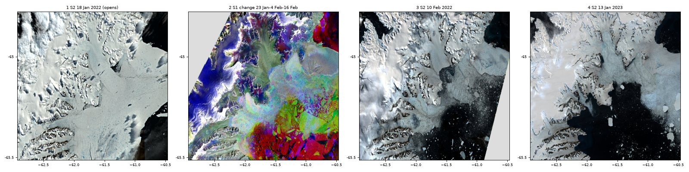
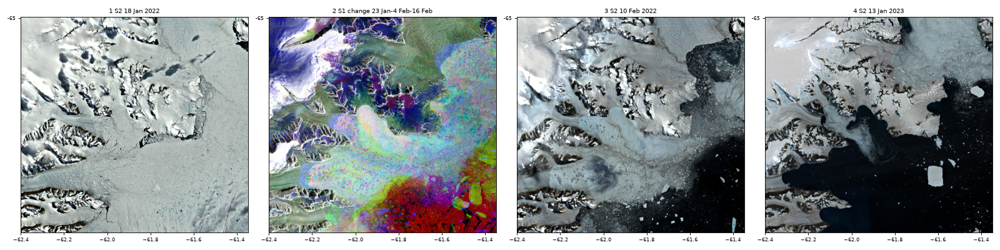

# Larsen B 2022: the fast-ice breakout and the glaciers that followed

Studio project: not saved yet. Title "Exp - Larsen B 2022 fast-ice breakout and glacier retreat"; Save will store
it under that title in kebab case (check "My projects" first, see the repository README).
Files: `studio_script.py` (the code pasted in Studio), `seed.js` (seeds the Studio editor with it),
`run_config.json` (the editor settings used for local tests).

> **Presenting this scenario?** Follow the [presenter notes](presenter-notes.md): the layer to open
> with, then what to show and what to say at each step (2-3 minutes).

## When the sea ice went, the glaciers ran

The Larsen B embayment lies on the east coast of the Antarctic Peninsula, open to the Weddell Sea. In 2011 sea
ice froze to the coast there and stayed: "In late March 2011, landfast sea ice
(hereafter, "fast ice") formed in the northern Larsen B embayment and persisted continuously as multi-year fast
ice until January 2022" (Ochwat et al. 2024). In those eleven years the glaciers that flow into the embayment
slowed, thickened and grew ice tongues "that extended up to 16 km from the 2011 ice fronts"; the fast ice
"provided significant resistive stress to ice flow" (Ochwat et al. 2024).

In late January 2022 a strong ocean swell arrived from the north-east. "Wave propagation to the ice front was
facilitated by a 12-year low in sea ice concentration in the northwestern Weddell Sea, creating a near-ice-free
corridor to the open ocean", and "Fast-ice breakout began in late January 2022 and was closely followed by retreat
and breakup of both the fast-ice mélange and the glacier ice tongues" (Ochwat et al. 2024). In the months that
followed, the three main glaciers more than doubled their speed, lost 9 to 11 m of elevation and calved
"floating and grounded ice", retreating by 11 km (Crane), 25 km (Hektoria) and 18 km (Green) (Ochwat et al.
2024). A follow-up paper by the same group is titled "Record grounded glacier retreat caused by an ice plain
calving process" (Ochwat et al. 2025; its abstract was not retrieved, so only its title is used here).

How this connects to climate, and how sure it is: the study documents a chain of events in one summer and the
months after. Sea ice in the north-western Weddell Sea was at a 12-year low, which let the swell reach the coast;
the fast ice broke out after it arrived ("The fast-ice breakup is linked to the arrival of a strong ocean swell
event", Ochwat et al. 2024); the glaciers lost the ice that buttressed them, sped up and calved floating and
grounded ice. A 12-year low is the lowest in 12 years, not by itself a trend, and the abstract retrieved here does
not attribute it to climate change; neither does this scenario. Grounded ice adds to sea level once it reaches
the ocean, but only the part above flotation counts, and floating ice does not (general physics; no amount is
given or computed here).

The scenario shows the northern embayment (box 62.6-60.8W, 65.5-64.9S, about 84 x 66 km) days before the
breakout, during it (the radar passes, then a picture two weeks in) and a year later.

*The four layers at tile zoom 10 (about Studio map zoom 9, the opening view), 62.9-60.5W, 64.8-65.5S, rendered on
a local copy of the backend (titiler-openeo c9b6ee3, the production commit) against Planetary Computer. Grey =
no data: outside the radar swath (panel 2, north-west) and the 10 Feb Sentinel-2 swath (panel 3, south-east); in
Studio these corners are blank and the base map shows through. Panel 2: the bright red north-east corner is open
sea roughened by wind, not ice. Panel 1: the straight colour step over the water in the south-east corner is a
Sentinel-2 tile edge.*

*The western half (62.4-61.35W, 65.0-65.44S) at tile zoom 11 (about map zoom 10). Panel 3: on 10 Feb 2022 a
glacier tongue with a lobed front still fills the middle of the view while open water and floes cover the east.
Panel 4: by 13 Jan 2023 that tongue is gone and open water reaches into the inlet on the left. Panel 2: red over
the southern part of panel 3's open water, where the radar saw ice on 23 Jan and dark water afterwards. The open
water and floes in the north-east of panel 3 (around 61.6W 65.05-65.15S) come out blue to purple and speckled, not
red, and the tongue that stayed is a pale speckle of many colours, not flat grey. The dark, blurry patch on the
tongue in panel 3 is a cloud shadow.*

The 2022-2023 edges and fronts are read from the images, not measured; the retreat distances are the published
ones (Ochwat et al. 2024).

## The four layers

### 1. 18 Jan 2022: true colour, before (opens here)

- **What you see:** the embayment is filled with **white-grey fast ice**; zoomed in, blue melt ponds dot it.
  Glaciers flow into it from the mountains to the west and north-west, their flow lines visible on the ice.
  **Black** = open water: the sea east of the fast-ice edge (east side of the view) and a small opening near
  61.4W 65.05S. Rock ridges show brown between the glaciers. A few clouds and their diffuse grey shadows lie on
  the fast ice in the south-east, and clouds cover parts of the mountains in the north-west: they are not open
  water. Over the open sea in the south-east corner, a straight north-south colour step near 60.85W (brownish
  east of it, black west of it) is the western edge of Sentinel-2 tile 20DPN (its catalogue footprint, our
  check): the two tiles' colours over water differ slightly. It is not a feature.
- **How it is made:** Sentinel-2B true colour (`sentinel-2-l2a`, bands B04/B03/B02, orbit R095, ~13:19 UTC,
  tile 20DNN and its neighbours of the same pass), reflectance 0-1.25 stretched linearly to 0-255. The no-data
  mask shared with layers 3 and 4 has no effect on this date (see the technical chain).
- **Method:** in visible light, open water absorbs most sunlight and snow-covered ice reflects most of it:
  all-wave albedos measured in the Antarctic sea-ice zone range from 0.07 for open water to 0.87 for thick
  snow-covered ice under cloud (Brandt et al. 2005). This is an ordering, not a Sentinel-2 threshold. The stretch
  goes to 1.25 because L2A reflectances of snow and ice here reach above 1 (p90 1.15 on 18 Jan, our test renders):
  with 0-1, a quarter of the pixels came out pure white and the texture of the fast ice was lost (our test renders).
- **Technical chain:** `load_collection("sentinel-2-l2a", bands=["B04","B03","B02"])`, 18 Jan 13:15-13:25 UTC ->
  `apply_pixel_selection("first")` (mosaic of the pass's tiles) -> mask pixels equal to -0.1 (DN 0 after the
  backend's scale and offset) -> clip 0-1.25 -> 0-255. 18 Jan 2022 predates processing baseline 04.00, so its
  products have no offset: no-data comes out as 0.0, not -0.1, and the mask has no effect. Nothing shows: the pass
  covers the whole view, and in our renders its swath edges come out transparent (not black) even at tile zoom 6.

### 2. 23 Jan - 16 Feb 2022: radar change (the breakout, pass by pass)

- **What you see:** in the southern and south-eastern embayment, large **red** areas: ice that was there on
  23 Jan and gone by 4 Feb. Further east, **yellow-green** patches: ice still there on 4 Feb, gone by 16 Feb.
  These two colours mark only part of the breakout (see "Our check"): elsewhere, ice that went shows as
  **purple** (bright on 23 Jan, dark on 4 Feb, bright again on 16 Feb, when the water was rough again from wind or
  drifting floes) or as a speckled mix of colours. Ice that stayed in place, in the centre and in front of the
  glaciers, is a **pale speckle of many colours**: grey only on average, seldom flat grey pixel by pixel. Zoomed
  in, sharp **black** wedges inside the red: cracks that were already open water on 23 Jan and stayed open. On
  land and on the glaciers, blue, purple or orange tones come from the snow (see below), and over the open sea
  (the bright red north-east corner) colour only says which day was windier: that red is not ice. Read this
  layer at the opening zoom: one step closer, the centre of the view is mostly speckle, and open water north-east
  of the glacier tongue comes out blue to purple, like ice that stayed.
- **How it is made, for non-specialists:**
  1. *One radar picture.* Sentinel-1 sends microwave pulses and measures the echo. Rough surfaces such as
     ridged floes and wind-roughened water send a lot back and look bright; calm open water sends little back
     and looks dark (Dierking 2013). Here the fast ice was bright on 23 Jan (above -15 dB on our test tiles).
     Radar sees through cloud.
  2. *Three comparable pictures.* The three passes (23 Jan, 4 Feb, 16 Feb) come from the same Sentinel-1A orbit
     (relative orbit 38, ~08:02 UTC), 12 days apart, so they look at each spot from the same angle and the
     differences come from the surface. Each is calibrated, has the instrument noise removed, is put on a
     decibel scale and stretched to grey from -24 dB (black) to -4 dB (white).
  3. *One date per colour.* 23 Jan goes into the **red** channel, 4 Feb into **green** and 16 Feb into **blue**.
     A pixel equally bright on all three dates is **grey**; a colour tells when it was bright: red = only on
     23 Jan; yellow (red + green) = on 23 Jan and 4 Feb but not 16 Feb.
  4. *Why that shows the breakout.* Fast ice is bright and open water is mostly dark, so fast ice that broke
     out and drifted away between two passes turns from bright to dark: red if it went before 4 Feb, yellow if
     before 16 Feb. Ice that stayed in place stays about as bright: grey in principle. In practice speckle and
     the summer surface make it a pale mix of colours that is grey only on average (see "Our check").
- **Our check** (our computation on the zoom-10 tiles of the box, against layers 1 and 3: open water = reflectance
  below 0.25 on 10 Feb, bright snow or ice = above 0.73 on 18 Jan, with no land mask; the check scripts are kept
  with the build evidence, not in this repository). Where the colours appear they mostly mean what the legend
  says: 72 % of the red pixels, 66 % of the yellow and 57 % of the purple were not open water on 18 Jan and are
  open water on 10 Feb, against 11 % of the grey pixels (counting only bright snow or ice on 18 Jan, 53 % of the
  red). About a tenth of the red pixels (10 %) were open water on both 18 Jan and 10 Feb: most likely sea
  roughened by wind on 23 Jan, not ice. And the colours cover only part of the breakout: of the pixels that
  turned from bright snow or ice on 18 Jan to open water on 10 Feb, only about a quarter are red (27 %) and a
  fifth yellow (18 %); the rest are purple (12 %), grey (10 %), black (5 %) or mixed colours. Sea ice and
  glacier tongue that stayed in place through 10 Feb (and was open water a year later) averages to grey, but only
  about a fifth of its pixels (21 %) are grey on their own.
- **Limits:** this is midsummer. Wet snow lowers C-band backscatter, which is how wet snow is mapped from
  repeat-pass radar (Nagler & Rott 2000), so on land and glaciers snow melting or refreezing between passes gives
  colours that have nothing to do with motion. Wind changes the brightness of open water. Single pixels are
  grainy (speckle): read large areas. Red and yellow-green show where the breakout is clearest, not all of it.
- **Method:** fast ice is mapped from radar as the ice that stays the same between repeat images. Karvonen (2018),
  in the Kara and Barents seas, uses the temporal cross-correlation between adjacent daily dual-polarised
  Sentinel-1 mosaics, and reports lower detection rates in the melt-down season than in winter (the abstract gives
  no cause; the melt effect above would be consistent with it). This layer uses one polarisation (HH) and three
  passes 12 days apart, and shows the comparison as colour, read by eye, instead of computing it: a visual reading
  of that principle, not an automated product. It is the radar-change layer of the North Water scenario with a
  different orbit and dates. The report that proposed this scenario suggested
  11 Jan / 23 Jan / 4 Feb; on 11 Jan the fast ice that later stayed was darker (probably wet snow), so it came
  out cyan instead of grey, and the triplet was moved 12 days later.
- **Technical chain:** for each date, `load_collection("sentinel-1-grd", bands=["hh"])` filtered on
  `sar:instrument_mode = IW` and `sat:relative_orbit = 38`, 07:57-08:07 UTC (in 2021-2022 the catalogue spells
  `platform` "SENTINEL-1A" in upper case, so the North Water `platform` filter would miss it) ->
  `sar_backscatter` (sigma0 on the ellipsoid, thermal-noise removal) -> mosaic of the 2 slices -> floor at 1e-4
  (noise removal clamps the darkest pixels to 0) -> 10 log10 -> band renamed `pass0/1/2` -> `merge_cubes` into one
  3-band cube -> stretch -24..-4 dB to 0-255.

### 3. 10 Feb 2022: true colour, two weeks into the breakout

- **What you see:** the eastern and southern embayment is now **black** open water with white **floes**, some
  of them kilometres across, and brash ice. The western embayment still holds **pale blue-grey** ice: the glacier
  tongues and the mélange in front of them, with a lobed front in the middle of the western half. Ice is still in
  place in the north-centre. A diffuse blue-grey cloud shadow lies on the lobed tongue: the ice texture runs
  through it, and it is not open water. The south-east corner is outside this pass (blank: the base map shows
  through); a broken one-pixel yellow line along that swath edge is an edge artefact, not a feature.
- **How it is made:** as layer 1, Sentinel-2B, orbit R138, 10 Feb ~13:29 UTC (scene cloud 45 % over the whole
  tile; the embayment is mostly clear, apart from the cloud shadow on the tongue).
- **Method:** as layer 1. This picture falls between the second and third radar passes, which is why it
  can be used to check the radar colours.

### 4. 13 Jan 2023: true colour, a year later

- **What you see:** **black** open water now covers the southern embayment and reaches far west into the inlets
  where the glacier tongues and mélange still stood on 10 Feb 2022 (compare layer 3 at map zoom 10). Large
  tabular icebergs drift in it. The north-centre is covered by pale grey ice.
- **How it is made:** as layer 1, Sentinel-2B, orbit R095, 13 Jan 2023 ~13:19 UTC (each tile exists twice, in
  its original and in a 2024 reprocessing; `first` takes one of them).
- **Method:** as layer 1. Ochwat et al. (2024) give the retreat of the three glaciers; this layer only shows
  where open water replaced the tongues, it does not locate or measure each glacier front.

## Choices and limits

- **Sentinel-2 instead of the proposed Landsat.** The research report proposed Landsat 8/9 scenes of path
  216/106 (16 Jan 2022, 9 Feb 2022, 20 Feb 2023). Their footprints cover only the eastern half of the box (45-48 %)
  and miss the glacier outlets: they stop along a line from about 61.3W 64.9S to 62.0W 65.5S. Only Landsat paths
  217/106 and 218/106 cover the whole box, and after the breakout none of their scenes is clear (41-100 % scene
  cloud, cloud over the western half on inspection). Sentinel-2 tile 20DNN covers 95 % of the box, and its
  neighbours of the same pass fill the rest. It has clear dates days before the breakout, two weeks into it and a
  year later, at 10 m. The North Water true-colour code is reused as is, only with a wider stretch.
- **Radar seam.** Each radar pass is two slices that meet along a line from about 62.6W 65.0S through 62.0W
  65.2S and 61.6W 65.3S to 60.9W 65.5S, across the southern embayment. A dotted one-pixel line can show along it
  when zoomed in. In our tests at tile zoom 12-13 on three points of the seam, no tile went blank. In North Water a
  strip up to ~15 km wide next to the seam turned blank when zoomed in, because the catalogue footprints stop
  short of the data (a backend issue, see the repository README). If that happens, zoom out.
- **Coverage.** The radar swath misses a small triangle in the north-west corner of the box (west of a line from
  62.4W 64.9S to 62.6W 65.0S); the 10 Feb Sentinel-2 pass misses a small south-east corner.
- **Summer.** All four layers are in the austral summer: melt ponds, wet snow and low sun (sun elevation 31-38°).
  Sentinel-2 L2A colours over water and ice come from a land atmospheric correction, so they are relative.
- **Items per tile** at the opening zoom (tile zoom 9-10): at most 4 Sentinel-2 items for layers 1 and 3 and 8
  for layer 4 (each 2023 tile exists in two processing versions), and 2 slices per radar pass (6 for layer 2),
  against the backend's limit of 20 per layer. Zoomed out, layer 4 reaches that limit first: at tile zoom 6 (map
  zoom about 4.5-5.5) some of its tiles next to the box need 21 or more items and fail with "ItemsLimitExceeded"
  (our local test; the box's own tiles still render). At tile zoom 7 (map zoom about 6) layer 4 needs at most 20
  items on the tiles around the box (our count), so stay at map zoom 6 or closer on that layer.
- **Load times** (five local test runs, one tile at a time, against Planetary Computer): radar-change tiles took
  0.1-25 s (median 3-11 s depending on the run), and up to 31 s in a run where Planetary Computer was
  rate-limiting; true-colour tiles mostly 1-3 s at the opening zoom (a few up to 16 s). Zoomed out to tile zoom
  6-7, true-colour tiles took up to about a minute.

## Data

| Layer | Collection | Time window (UTC) | Bands |
|---|---|---|---|
| 1 | `sentinel-2-l2a` (Sentinel-2B, orbit R095, tiles 20DNN, 20DNP, 20DPN, ...) | 2022-01-18 13:15-13:25 | B04, B03, B02 |
| 2 | `sentinel-1-grd` (IW, Sentinel-1A, relative orbit 38, `1SSH`) | 2022-01-23, 02-04, 02-16, 07:57-08:07 | HH |
| 3 | `sentinel-2-l2a` (Sentinel-2B, orbit R138) | 2022-02-10 13:25-13:35 | B04, B03, B02 |
| 4 | `sentinel-2-l2a` (Sentinel-2B, orbit R095) | 2023-01-13 13:15-13:25 | B04, B03, B02 |

Radar items: `S1A_IW_GRDH_1SSH_20220123T080159_..._041585_04F245` and `..._20220123T080224_...`, and the same pair
for 4 Feb (`041760_04F834`) and 16 Feb (`041935_04FE5E`).

## References

Every DOI checked on Crossref.
- Brandt, Warren, Worby & Grenfell (2005), J. Climate 18(17), 3606-3622, <https://doi.org/10.1175/JCLI3489.1>
- Dierking (2013), Oceanography 26(2), <https://doi.org/10.5670/oceanog.2013.33> (abstract not retrieved)
- Karvonen (2018), The Cryosphere 12, 2595-2607, <https://doi.org/10.5194/tc-12-2595-2018>
- Nagler & Rott (2000), IEEE Trans. Geosci. Remote Sens. 38(2), 754-765, <https://doi.org/10.1109/36.842004>
  (abstract not retrieved)
- Ochwat, Scambos, Banwell, Anderson, Maclennan, Picard, Shates, Marinsek, Margonari, Truffer & Pettit (2024),
  The Cryosphere 18, 1709-1731, <https://doi.org/10.5194/tc-18-1709-2024>
- Ochwat, Scambos, Anderson, Winberry, Luckman, Berthier, Bernat & Antropova (2025), Nature Geoscience 18,
  1117-1124, <https://doi.org/10.1038/s41561-025-01802-4> (title only)

## Credits

Contains modified Copernicus Sentinel data 2022-2023, via Microsoft Planetary Computer.
