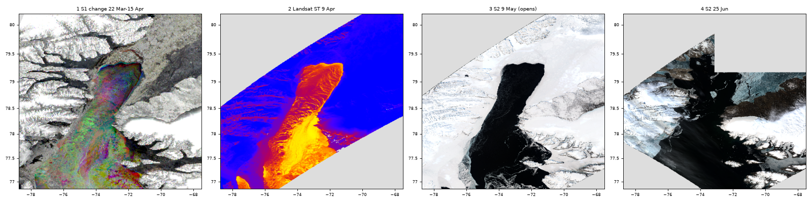

# North Water polynya, winter to early summer 2026

Studio project: <https://studio.mpc.ds.io/editor/exp-north-water-polynya-2026-sentinel-1-radar>
(title "Exp - North Water polynya 2026 Sentinel-1 radar"; it now uses three satellites, the title was
kept so the live project could be updated in place).
Files: `studio_script.py` (the code pasted in Studio), `seed.js` (seeds the Studio editor with it),
`run_config.json` (the editor settings used for local tests).

## The North Water and its ice arch

The North Water (Pikialasorsuaq), between Ellesmere Island (Canada, west) and Greenland (east), is the
largest recurring polynya of the Arctic: an area of open water and thin ice inside the winter sea ice.
Pack ice drifting south through Nares Strait usually jams into an **ice arch** across the head of Smith
Sound in winter. South of the arch, winds and currents keep sweeping the new ice away, so the sea stays
open or covered by thin new ice; the ocean loses a lot of heat there to the very cold air. The arch
usually breaks down in June or July (Vincent 2019).

*The four layers at map zoom 6, rendered on a local copy of the backend (identical to production).*

The 2026 dates are read from these Sentinel-1/2 images only, not from ice charts: the edge is absent on
the 2 Feb radar pass and present on 26 Feb, intact on 9 May, still at the same latitude on the 14 Jun
radar pass, and broken up on 25 Jun. The edge at ~79.3N is where the arch usually sits
(79.2 +/- 0.5N in the 1968-1979 ice charts, Vincent 2019).

## The four layers

### 1. 22 Mar - 15 Apr 2026: radar change (where the ice does not move)

- **What you see:** north of a curved edge at ~79.3N, Kane Basin is **grey**: the pack ice there did not
  move. South of it, the polynya through Smith Sound is **coloured**: its surface kept changing. Landfast
  ice in the fjords and the land are grey too.
- **How it is made, for non-specialists:**
  1. *One radar picture.* Sentinel-1 sends microwave pulses and measures the echo. Rough surfaces
     (ridged ice, floes, wind-whipped water) send a lot back and look bright; smooth ones (calm water,
     thin new ice) look dark. Radar sees through cloud and in the polar night. Each pass gives a
     black-and-white picture of how rough the surface is.
  2. *Three comparable pictures.* The appearance also depends on the angle the satellite looks from, so
     the three pictures (22 Mar, 3 Apr, 15 Apr) come from the same Sentinel-1A orbit, which passes over
     the same spot every 12 days at the same time (~12:09 UTC) and the same angle. Differences then come
     from the surface, not the satellite. All three are processed the same way: calibrated, with the
     instrument's own noise removed, put on a logarithmic (decibel) scale, and stretched to grey from
     -24 dB (black) to -4 dB (white).
  3. *One date per colour.* A screen makes colours from red, green and blue light. Here 22 Mar goes into
     the **red** channel, 3 Apr into **green** and 15 Apr into **blue**. Where a pixel is equally bright on
     the three dates the three colours balance into a **neutral grey** (from black to white). Where the
     brightness changed, a **colour** appears, and it tells when the surface was brightest: red = 22 Mar,
     green = 3 Apr, blue = 15 Apr, and mixes such as yellow (red + green) = bright on 22 Mar and 3 Apr but
     dark by 15 Apr.
  4. *Why that shows the arch.* An arch is ice jammed so tightly that it stops moving: the same floes and
     ridges sit in the same place on all three passes, so it is grey. In the polynya the surface is
     different on every pass, so it is coloured. The line between grey and colour is the arch. A single
     image cannot show that ice does not move; it takes several dates. (Photographers know the same trick
     as the Harris shutter: three exposures through red, green and blue filters, still things look
     normal and moving things leave rainbow ghosts.)
- **Limits:** radar images are grainy (speckle), so single pixels show random colour: read large areas.
  Smooth, featureless ice that drifts can still look grey. The three passes span 24 days.
- **Method:** landfast (static) ice is mapped as the area that stays the same in consecutive SAR images of
  the same geometry (Karvonen 2018). Li et al. (2018) recommend 3-4 calibrated images at the same
  incidence angle with a maximum separation of less than 20 days; this triplet spans 24 days and shows the
  comparison as colour instead of computing it, so it is a visual reading of that principle, not their
  automated product (over 24 days, grey is a stricter test of immobility). One orbit removes the HH
  incidence-angle slope (Mäkynen & Karvonen 2017); HH polarisation is preferred for ice-water
  discrimination and polynya surfaces decorrelate between passes (Dierking 2013); the EW radiometric
  stability (0.32 dB) is about 4 of 255 grey levels, and -24..-4 dB lies inside the HH range of sea ice
  (Park et al. 2020). An arch stops the ice transport for months (Moore et al. 2023); ice motion tracked
  in sequential SAR images shows the flux through the strait ceasing while an arch holds (Kwok 2005;
  Moore et al. 2023).
- **Technical chain:** for each date, `load_collection("sentinel-1-grd", bands=["hh"])` filtered on
  `sar:instrument_mode = EW` and `platform = sentinel-1a`, pass time +/- 5 min -> `sar_backscatter`
  (sigma0 on the ellipsoid, thermal-noise removal) -> mosaic of the 2 slices -> floor at 1e-4 (noise
  removal clamps the darkest pixels to 0) -> 10 log10 -> band renamed `pass0/1/2` -> `merge_cubes` into
  one 3-band cube -> stretch -24..-4 dB to 0-255.

### 2. 9 Apr 2026: surface temperature (Landsat 9)

- **What you see:** a warm tongue starting at the arch (~79.3N) and filling the polynya, with the same
  shape as layer 1's coloured area: **yellow** (about -2 C, the freezing point of sea water) = open water,
  in southern Smith Sound; **orange** (-5 C), **red** (-13 C) and **purple** (-17 C) = thin new ice (the
  thinner, the warmer); **blue** (colder than about -23 C) = thick pack ice and land. Sunlit Ellesmere
  slopes show as purple-red streaks on land; the swath leaves the north-west and south-east corners blank.
- **How it is made:** Landsat 9 thermal band (`landsat-c2-l2`, `lwir11`, 100 m), scenes of path 39
  rows 2-5 on 9 Apr 18:02-18:03 UTC, converted to kelvin by the backend and coloured with a fixed
  temperature scale.
- **Method:** thermal infrared is how the arch and the North Water are mapped (Vincent 2019; Preußer et
  al. 2015, thin ice from MODIS ice-surface temperature), and a warm surface in the cold season marks
  thin ice (Yu & Rothrock 1996). Landsat Collection 2 surface temperature comes from per-pixel atmospheric
  compensation of the thermal band with ancillary emissivity (Cook et al. 2014); a comparable
  single-channel Landsat 8 retrieval over Arctic sea ice had a -1.55 K bias and a 2.40 K error against
  buoy skin temperatures (Fan et al. 2020). The layer shows temperature only; no ice thickness is
  computed. Polynyas dominate the winter heat budget, with an ocean-to-atmosphere heat flux about two
  orders of magnitude higher than the surrounding pack ice (Vincent 2019).

### 3. 9 May 2026: true colour, the arch and the open polynya (opens here)

- **What you see:** a sharp white/black edge at ~79.3N from ~75W to ~71.5W: the arch. South of it the
  polynya is **black** down to ~77N, with grey thin-ice filaments in southern Smith Sound; Kane Basin and
  the land are white. Black means open water **or** very thin new ice: they look alike in visible light
  (a same-day Landsat temperature reading just under the arch, -3.8 C, suggests thin new ice there).
- **How it is made:** Sentinel-2B true colour (`sentinel-2-l2a`, bands B04/B03/B02, orbit 127,
  ~18:19 UTC), reflectance 0-1 stretched linearly to 0-255. Pixels with no data are hidden (many
  Sentinel-2 files on Planetary Computer carry no no-data flag, which would show as opaque black).
- **Method:** visible imagery is the basis of the 40-year arch record and is best for the break-down
  (Vincent 2019). Brightness rises from open water through thin-ice types to snow-covered ice (all-wave
  albedo 0.07 for open water to 0.87 for thick snow-covered ice under cloud, Brandt et al. 2005: an
  ordering, not a threshold).

### 4. 25 Jun 2026: true colour, the arch has broken up

- **What you see:** the arch-shaped edge is gone; open water (black) now reaches north of where it was,
  blue-grey melting floes lie in the former polynya and in Kane Basin, and the coasts are snow-free brown.
- **How it is made:** as layer 3, Sentinel-2A, 25 Jun ~18:19 UTC.
- **Method:** as layer 3; melt ponds lower ice albedo from 0.8-0.9 to about 0.4 (Perovich et al. 2002),
  which is why melting floes look blue-grey.

## Choices and limits

- The first version had 8 single-date radar frames every 24 days; they repeated four stages and were
  replaced by four layers from three satellites and three physical quantities (radar roughness change,
  temperature, visible colour).
- Each radar pass is two slices that meet just north of a line from 76.0N 66.7W to 77.3N 82.1W (northern
  Baffin Bay): a thin gap can show along it, and zoomed in a strip up to ~15 km wide just north of it can
  turn blank, because the catalogue footprints stop short of the data (a backend issue; zoom out).
- Brightness-to-ice-type readings (Brandt et al. 2005; Perovich et al. 2002) are applied as orderings,
  not as Sentinel-2 reflectance thresholds. The Landsat temperature colours are approximate anchors.
- Radar-change tiles are the slowest (1-13 s; three passes, up to six slices per tile).

## Data

| Layer | Collection | Time window (UTC) | Bands |
|---|---|---|---|
| 1 | `sentinel-1-grd` (EW, Sentinel-1A) | 2026-03-22, 04-03, 04-15, 12:05-12:15 | HH |
| 2 | `landsat-c2-l2` (Landsat 9) | 2026-04-09 18:00-18:06 | lwir11 |
| 3 | `sentinel-2-l2a` (Sentinel-2B) | 2026-05-09 18:15-18:25 | B04, B03, B02 |
| 4 | `sentinel-2-l2a` (Sentinel-2A) | 2026-06-25 18:15-18:25 | B04, B03, B02 |

## References

Every DOI checked on Crossref.
- Brandt, Warren, Worby & Grenfell (2005), J. Climate 18, 3606-3622, <https://doi.org/10.1175/JCLI3489.1>
- Cook, Schott, Mandel & Raqueno (2014), Remote Sens. 6, 11244-11266, <https://doi.org/10.3390/rs61111244>
- Dierking (2013), Oceanography 26(2), 100-111, <https://doi.org/10.5670/oceanog.2013.33>
- Fan et al. (2020), Remote Sens. Environ. 248, 111975, <https://doi.org/10.1016/j.rse.2020.111975>
- Karvonen (2018), The Cryosphere 12, 2595-2607, <https://doi.org/10.5194/tc-12-2595-2018>
- Kwok (2005), Geophys. Res. Lett. 32, L24502, <https://doi.org/10.1029/2005GL024768>
- Li, Ouyang, Hui, Cheng, Shokr & Heil (2018), IEEE JSTARS 11, 4737-4746, <https://doi.org/10.1109/JSTARS.2018.2882602>
- Mäkynen & Karvonen (2017), IEEE TGRS 55, 6170-6181, <https://doi.org/10.1109/TGRS.2017.2721981>
- Moore, Howell & Brady (2023), Sci. Rep. 13, 9809, <https://doi.org/10.1038/s41598-023-36179-0>
- Park et al. (2020), The Cryosphere 14, 2629-2645, <https://doi.org/10.5194/tc-14-2629-2020>
- Perovich, Grenfell, Light & Hobbs (2002), J. Geophys. Res. 107(C10), 8044, <https://doi.org/10.1029/2000JC000438>
- Preußer, Heinemann, Willmes & Paul (2015), Remote Sens. 7, 15844-15867, <https://doi.org/10.3390/rs71215807>
- Vincent (2019), Sci. Rep. 9, 20278, <https://doi.org/10.1038/s41598-019-56780-6>
- Yu & Rothrock (1996), J. Geophys. Res. 101(C11), 25753-25766, <https://doi.org/10.1029/96JC02242>

## Credits

Contains modified Copernicus Sentinel data 2026, via Microsoft Planetary Computer. Landsat data courtesy
of the U.S. Geological Survey.
