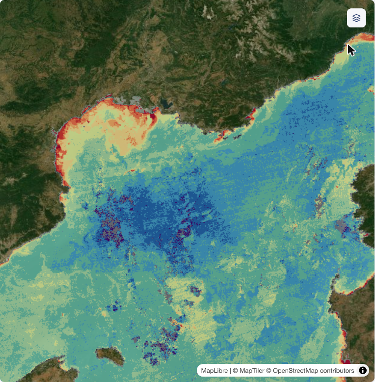

# Winter 2013, 8 days at a time

Studio project: <https://studio.mpc.ds.io/editor/exp-nw-med-deep-convection-2013-modis-8-day-sequence>
(title "Exp - NW Med deep convection 2013 MODIS 8-day sequence"; opens on layer 1).
The background, the colour scale and the method shared by the four projects are in the
[scenario README](../README.md).

*Layer 1 (25 Jan-1 Feb 2013) as it opens in Studio: the first patch in the middle of the gulf, land
transparent. Screenshot of production, 21 Oct 2026.*

## Winter 2013

2013 is the reference winter of Houpert et al. (2016): the mixed layer reached the bottom (about 2300 m) at
the LION mooring on 13 February, the main mixing ended on 28 February, and a second mixing event on 13-17 March
reached the bottom again and ended on 21 March (Table 4). Our reading of the mooring record (see the scenario
README) puts the mixed layer below 1000 m from 27 January to 23 March. The mixed patch reached its largest
extent, 28,000 ± 3,000 km² with a mixed layer deeper than 1000 m, in late February (Testor et al. 2018).
The bloom started at the periphery of the patch around 2 March ± 4 days, in its centre around 3 April ± 4 days,
peaked on 7-9 April, and the sea returned to summer oligotrophy in May (Mayot et al. 2017).

## The eleven layers

All MODIS-Aqua 8-day composites from 25 January to 14 April 2013 are 92-99 % clear; the one before
(17-24 January) is 62 % clear and is left out, and 1-8 May stands for the decline. "Clear" is the share of the
ocean in 2.5-8.5E 40.5-44N that the MODIS state QA flags as clear.

| # | Composite | What you see | Clear |
|---|---|---|---|
| 1 | 25 Jan-1 Feb | The patch appears as the mixing deepens (below 1000 m at LION from 27 Jan). **Opens here.** | 97 % |
| 2 | 2-9 Feb | The patch grows. | 95 % |
| 3 | 10-17 Feb | The largest dark-purple (< 0.15) core of the winter. | 93 % |
| 4 | 18-25 Feb | An elongated south-west to north-east patch: the week of Houpert et al. (2016, Fig. 8g; "18-25 Feb. 2013", p. 8154). Proxy areas 39,400 / 3,700 km² (< 0.25 / < 0.15) against 56,351 / 23,583 km² in their Table 4. | 98 % |
| 5 | 26 Feb-5 Mar | The widest < 0.25 envelope of the winter; the main mixing ends on 28 Feb. | 93 % |
| 6 | 6-13 Mar | Between the two mixing events: the patch shrinks and a ring of bloom grows at its edges. | 92 % |
| 7 | 14-21 Mar | The second mixing event (13-17 Mar) re-forms the patch with a dark-purple core. | 99 % |
| 8 | 22-29 Mar | The mixing is over; the bloom grows around the patch. | 92 % |
| 9 | 30 Mar-6 Apr | The bloom reaches the centre and fills the basin. | 97 % |
| 10 | 7-14 Apr | The bloom at its peak: proxy above 2 on 44 % of a 0.25° box around LION. | 99 % |
| 11 | 1-8 May | The bloom fades; low values come back offshore. | 95 % |

**The proxy against the published bloom dates:** edge onset on 6-13 Mar (published 2 Mar ± 4 days) and
maximum on 7-14 Apr (published 7-9 Apr).

## How it is made

As described in the [scenario README](../README.md) (data, proxy, clear-water test, colour classes), with
the **ocean mask**: only pixels flagged by the MODIS state QA as shallow, moderate or deep ocean are drawn, so
land, coastline and inland water are transparent. Each layer reads one composite (two MODIS tiles, h18v04 and
h18v05, mosaicked) plus its QA band; tiles take a few seconds (the mask makes them about 1.8x slower).

## Data

| Layer | Collection | Composite (first day = `temporal_extent` start) | Bands |
|---|---|---|---|
| 1-11 | `modis-09A1-061`, Aqua (`id` starts with `MYD09A1`) | 2013-01-25, 02-02, 02-10, 02-18, 02-26, 03-06, 03-14, 03-22, 03-30, 04-07, 05-01 | `sur_refl_b02`, `sur_refl_b03`, `sur_refl_b04`; `sur_refl_state_500m` (ocean mask) |

## History

- 20 Oct 2026: built with plain `load_collection` (replacing a 2-layer version that read two pinned items
  with `load_stac`); all 438 production tiles returned HTTP 200.
- 21 Oct 2026: ocean mask applied (land transparent).
- 21 Oct 2026: short description and layer labels for non-specialists; the details moved here. Process graphs
  unchanged.
