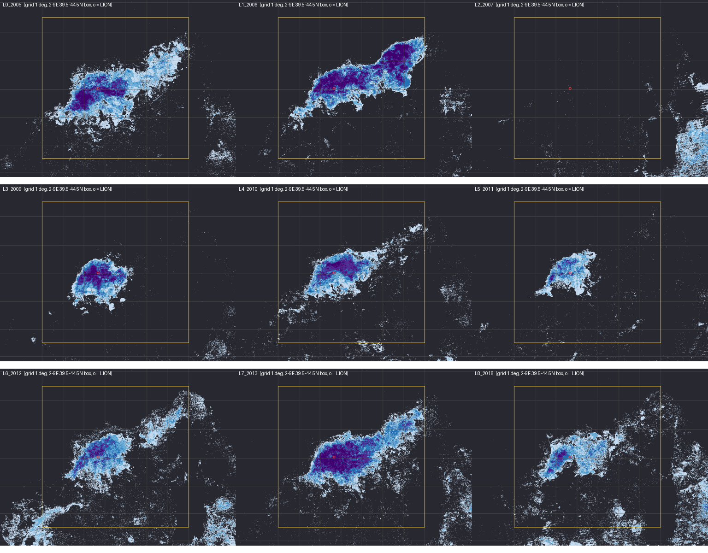

# Deep winters 2005-2018: weeks in the low-chlorophyll patch

Studio project: <https://studio.mpc.ds.io/editor/exp-nw-med-deep-winters-2005-2018-low-chl-weeks-modis>
(title "Exp - NW Med deep winters 2005-2018 low-chl weeks MODIS"; opens on layer 8, 2013).
The background, the evidence for each winter and the method shared by the four projects are in the
[scenario README](../README.md).

*The nine layers (2005, 2006, 2007; 2009, 2010, 2011; 2012, 2013, 2018) from production tiles at map zoom 7;
yellow box 2-9E 39.5-44.5N, red circle = LION mooring.*

## What it shows

Where, and for how long, the low-chlorophyll patch held in each deep winter. For every pixel, the layer counts
in how many of the seven MODIS-Aqua 8-day composites that start on 25 Jan, 2 Feb, 10 Feb, 18 Feb, 26 Feb,
6 Mar and 14 Mar (5 and 13 Mar in the leap year 2012) the pixel was clear **and** in the < 0.25 class of the
proxy (dark purple or dark blue in the other projects). Together the seven composites cover 25 Jan-21 Mar
(25 Jan-20 Mar in 2012). The window and the classes are the same for every winter, so the footprints compare
between winters; 2007 is the winter without deep convection.

| Colour | Weeks in the patch (of 7) |
|---|---|
| light blue | 1 |
| blue | 2 |
| dark blue | 3 |
| purple | 4 |
| dark purple | 5-7 |
| none (transparent) | 0: never in the patch, never clear, or land |

## Results

Area with at least 3 weeks in the patch (production tiles at map zoom 7): 2006 37,800 km² > 2013 32,100 >
2005 21,000 > 2010 14,300 > 2009 13,600 > 2012 11,900 > 2018 6,900 > 2011 4,400 >> 2007 0. The 2013 core holds
5-7 weeks around LION (mean 4.6 weeks, the highest of all winters).

## Read with care

- **Cloud counts as "not in the patch"**, so cloudy winters look smaller: the February 2018 composites are only
  80-89 % clear.
- **The count mixes size and duration.** 2011 mixed early (bottom at LION on 27 Jan, Houpert et al. 2016,
  Table 4) and its patch had broken up by 18 Feb, so it scores low; 2005 kept its patch until mid-March and
  2006 had one from mid-January.
- The clear-water test also rejects some clear core pixels (see the scenario README), which lowers counts a
  little everywhere.

## How it is made

One `load_collection` over the seven composites keeps one time step per composite (two MODIS tiles
mosaicked per step). The blue/green ratio is computed per step; `mask` turns cloud, land and proxy ≥ 0.25
into no-data; `apply_pixel_selection` with `count` then counts the remaining steps per pixel, and the counts are
coloured. A map tile reads up to 14 items (7 composites x 2 MODIS tiles), so the first load of a layer is slow
(up to about 24 s). No ocean mask: land has no clear-water pixel, so it gets a count of 0 and stays transparent.

## Data

| Layer | Collection | Window (`temporal_extent`) | Bands |
|---|---|---|---|
| 1-9 | `modis-09A1-061`, Aqua (`id` starts with `MYD09A1`) | [<year>-01-25, <year>-03-15]: the composites starting 25 Jan to 14 Mar (13 Mar in 2012) | `sur_refl_b02`, `sur_refl_b03`, `sur_refl_b04` |

Winters: 2005, 2006, 2007, 2009, 2010, 2011, 2012, 2013, 2018.

## History

- 20 Oct 2026: built (the first multi-composite layer on this backend, possible since sentinel-hub/titiler-openeo#473);
  all 189 production tiles returned HTTP 200.
- 21 Oct 2026: short description and layer labels for non-specialists; the details moved here (the old
  description wrongly said that invalid pixels are grey: they are transparent). Process graphs unchanged.
