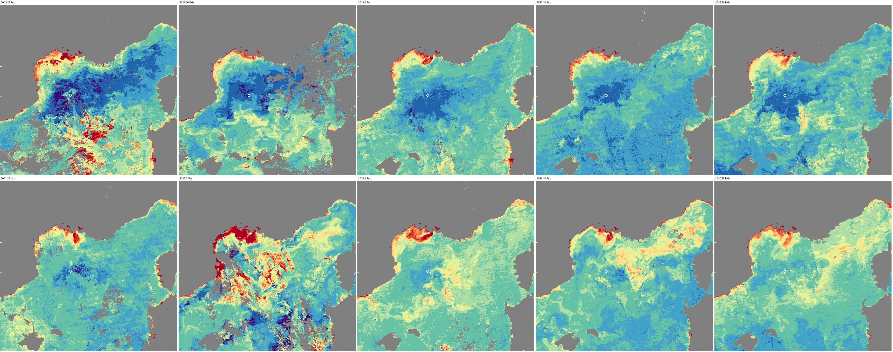

# Recent winters 2019-2026 against 2013 and 2018

Studio project: <https://studio.mpc.ds.io/editor/exp-nw-med-recent-winters-2019-2026-vs-2013-and-2018-modis-patch>
(title "Exp - NW Med recent winters 2019-2026 vs 2013 and 2018 MODIS patch"; opens on layer 1, 2013).
The background, the colour scale and the method shared by the four projects are in the
[scenario README](../README.md). For 2005-2012 see [deep-winters-compared](../deep-winters-compared/).

*The ten layers in project order (top: 2013, 2018, 2019, 2023, 2022; bottom: 2021, 2026, 2025, 2024, 2020),
from production tiles at tile zoom 7; white circle = LION mooring; grey = cloud or land.*

## What it shows

Since 2014 the winter mixing in the Gulf of Lion has mostly been much shallower than in 2009-2013: Coppola et
al. (2026, p. 5314) "since 2014 winter mixing has been considerably weaker (300–500 m on average, except in
2015 and 2018 when mixing reached ∼ 1500 m)". Margirier et al. (2020) link this decline of deep convection to
an abrupt warming and salinification of the intermediate waters. This project shows one MODIS-Aqua 8-day composite per
winter, at that winter's largest low-chlorophyll extent (or its clearest week when there was no patch): 2013
and 2018 for reference, then 2019-2026, ordered from the strongest to the weakest winter.

**Classes and depths.** No depths are published for 2019-2026, so the classes use our analysis of the LION
mooring (December-March maximum; range over four mixed-layer criteria, see the scenario README) together
with the low-chlorophyll area in 3-7E 41.3-43.2N:
- mixed to the seafloor: 2013;
- deep: 2018;
- moderate (about 350-1090 m): 2019, 2021, 2022, 2023, each with a low-chlorophyll patch;
- weak (about 400-600 m, the 2014-2017 range): 2025, 2026, no patch or hardly any;
- none (300 m or less): 2024, 2020.

**Which composite.** The composite with the largest low-chlorophyll area of January-March in 3-7E 41.3-43.2N
when it is clear enough (2013, 2018, 2022, 2021, 2026); for 2019, 2-9 Feb (99 % clear) instead of 25 Jan-1 Feb
(80 %, speckled core); for 2023, 10-17 Feb (99 % clear, 5 % of the core flagged by QA) instead of 26 Feb-5 Mar
(88 %, 24 % flagged); for the winters without a patch, the clearest composite near the LION maximum (for 2024,
10-17 Feb rather than 26 Feb-5 Mar, whose ~2,400 km² low-chlorophyll area lies offshore, at ~41.6N 6.0E).

## The ten layers

LION = December-March maximum mixed-layer depth at the mooring: Houpert et al. (2016) for 2013 (bottom), our
analysis otherwise (lowest-highest of four criteria). Areas in km² (< 0.25 / < 0.15 proxy classes) in
3-7E 41.3-43.2N. "Clear" is the share of the ocean in 2.5-8.5E 40.5-44N that the MODIS state QA flags as clear.

| # | Winter | Class | LION | Composite | What you see | Area | Clear |
|---|---|---|---|---|---|---|---|
| 1 | 2013 | seafloor | ~2300 m (bottom) | 26 Feb-5 Mar | The widest envelope of the winter. **Opens here.** | 28,400 / 6,200 | 93 % |
| 2 | 2018 | deep | 1497-1753 m | 26 Feb-5 Mar | Its largest patch; the eastern part under cloud | 21,200 / 2,100 | 80 % |
| 3 | 2019 | moderate | 500-1090 m | 2-9 Feb | A clear patch around LION | 13,000 / 400 | 99 % |
| 4 | 2023 | moderate | 450-850 m | 10-17 Feb | A patch on LION | 9,200 / 170 | 99 % |
| 5 | 2022 | moderate | 350-700 m | 26 Feb-5 Mar | A patch with core specks | 12,400 / 150 | 100 % |
| 6 | 2021 | moderate | 650-824 m | 25 Jan-1 Feb | A small patch | 3,600 / 370 | 95 % |
| 7 | 2026 | weak | 450-600 m | 6-13 Mar | Only specks; the bloom has already started | 1,900 / 580 | 87 % |
| 8 | 2025 | weak | 400-502 m | 2-9 Feb | No patch | 120 / 0 | 100 % |
| 9 | 2024 | none | 200-300 m | 10-17 Feb | No patch | 540 / 4 | 99 % |
| 10 | 2020 | none | 250-300 m | 18-25 Feb | No patch | 30 / 0 | 100 % |

The Studio labels round these ranges (for example "~2300 m", "1500-1750 m"). For 2021 the two sensors at
194 m and 472 m are flagged bad (quality flag 3) all winter and masked. Areas depend on the grid and the method
(up to about 20 % for one year, more between years), so they are not written into the layer labels.

## Read with care

- The patch shrinks with the mixing depth, but a patch alone does not prove mixing below 1000 m: 2019 has a
  patch as large as 2009-2011 with mixing to 500-1090 m (see the scenario README).
- 2023 is ordered before 2022 because its mixing was deeper at LION, although its patch is smaller.
- The 2025 composite is one of the items (5 Mar 2024-10 Jun 2025) with an empty `platform` property on
  Planetary Computer; selecting Aqua by item id is not affected, and the 2025 layer matches a local render pixel
  for pixel.

## How it is made

As described in the [scenario README](../README.md). No ocean mask: land is drawn grey, like cloud. Each
layer reads one composite (two MODIS tiles mosaicked); tiles take about 1-3 s.

## Data

| Layer | Collection | Composite (first day = `temporal_extent` start) | Bands |
|---|---|---|---|
| 1-10 | `modis-09A1-061`, Aqua (`id` starts with `MYD09A1`) | 2013-02-26, 2018-02-26, 2019-02-02, 2023-02-10, 2022-02-26, 2021-01-25, 2026-03-06, 2025-02-02, 2024-02-10, 2020-02-18 | `sur_refl_b02`, `sur_refl_b03`, `sur_refl_b04` |

LION mooring temperature records: SEANOE, <https://doi.org/10.17882/44411>.

## History

- 20 Oct 2026: built with plain `load_collection` (replacing a `load_stac` version that was never saved);
  774 of 798 production tile requests returned HTTP 200, the other 24 were requests the browser cancelled.
- 21 Oct 2026: short description and layer labels for non-specialists; the details moved here. The LION
  ranges of 2022 and 2023 now include the 0.02 °C criterion (were ~500-700 and ~600-850 m). Process graphs
  unchanged.
