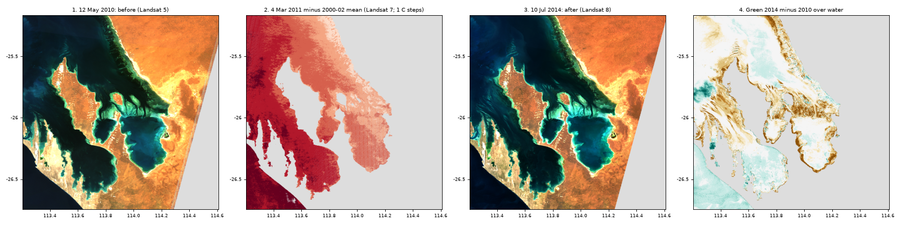
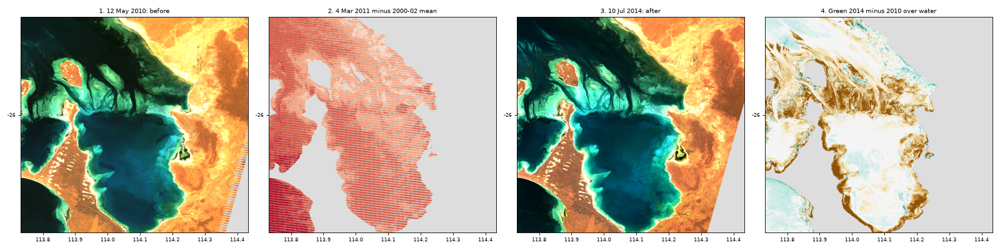

# Shark Bay seagrass and the 2010-11 marine heatwave

Studio project (not created yet): title "Exp - Shark Bay seagrass loss 2011 heatwave Landsat", which Studio will
save as <https://studio.mpc.ds.io/editor/exp-shark-bay-seagrass-loss-2011-heatwave-landsat>.
Files: `studio_script.py` (the code pasted in Studio), `seed.js` (seeds the Studio editor with it),
`run_config.json` (the editor settings used for local tests).
Status: every layer rendered on a local copy of the backend (titiler-openeo c9b6ee3, the production commit)
against Planetary Computer; nothing has been rendered in production yet (layer 2's Landsat 7 `lwir` band and
its four-overpass difference included: render it once there before presenting).

> **Presenting this scenario?** Follow the [presenter notes](presenter-notes.md): the layer to open
> with, then what to show and what to say at each step (2-3 minutes).

## Shark Bay and the heatwave

Shark Bay, a World Heritage Area on the coast of Western Australia, is a shallow bay of seagrass banks cut by
channels. It has "the largest C stock reported for a seagrass ecosystem" (Arias-Ortiz et al. 2018). "An
extreme MHW occurred across the Western Australian coastline in the austral summer of 2010–2011, exposing
marine communities to summer seawater temperatures 2–5°C warmer than average" (Strydom et al. 2020; MHW =
marine heatwave; see also Pearce & Feng 2013, cited by title only).
Strydom et al. (2020) mapped the whole Shark Bay World Heritage Area (about 13,000 km2, much larger than the
view) before (2002 and 2010) and after (2014 and 2016) and found "the single largest loss in dense seagrass
extent globally (1,310 km2) following an acute disturbance", "with the most extensive declines occurring in the
Western Gulf, Wooramel Bank and Faure Sill". Their ground truthing (622 points) showed the change was mostly a
loss of the seagrass *Amphibolis antarctica* rather than *Posidonia australis*. Arias-Ortiz et al. (2018)
"estimate that 36% of Shark Bay's seagrass meadows were damaged" (damaged = lost, or thinned from dense to
sparse, between their 2002 and 2014 maps, which cover about 78 % of the Marine Park). "Assuming that 10 to 50%
of the seagrass sediment C stock was exposed to oxic conditions" after the loss, they estimate that "between 2
and 9 Tg CO2 could have been released to the atmosphere during the following three years": a carbon store that
may have become a source of CO2. They add that heatwaves are "predicted to increase with further climate
warming".

The four layers use the same satellites as the published maps: Landsat 5 TM before the heatwave and Landsat 8
OLI after it (Arias-Ortiz et al. 2018), plus Landsat 7's thermal band during it.

*The four layers at tile zoom 10 (Studio map zoom ~9, the opening view), rendered on a local copy of the
backend (identical to production). Layer 2 covers the whole bay; the thin pale lines through it are the gaps
of the 2011 Landsat 7 image.*

*Zoom on the Faure Sill and Hamelin Pool (tile zoom 11, Studio map zoom ~10), where the change is clearest. In
layer 2 the Landsat 7 gaps show as regular, nearly horizontal empty stripes at this zoom. In layer 4 the brown
ring along Hamelin Pool's shores is most likely a lower water level in 2014 (see Choices and limits); the Faure
Sill banks between the channels are the better place to look.*

## The four layers

### 1. 12 May 2010: before (Landsat 5) (opens here)

- **What you see:** the bay in true colour, about seven months before the heatwave summer. On the shallow
  banks, **dark green to black patches** are dense seagrass meadows; the **long dark fingers** cutting across the
  banks are channels (deeper water); **bright turquoise** is bare or sparsely covered sand in shallow water; deep
  water is **black**; the land (Peron Peninsula in the middle, the mainland to the east, Faure Island in the
  eastern gulf) is orange and saturated. The meadows are clearest on the Wooramel Bank
  (along the east shore) and on the Faure Sill (the banks and channels between Faure Island and the mainland).
- **How it is made, for non-specialists:** Landsat measures how much sunlight each 30 m patch of the surface
  reflects in red, green and blue light; put together, they make a normal colour photo. In clear, shallow
  water the light reaches the bottom and comes back: bare sand reflects a lot, seagrass absorbs most of it,
  so meadows look dark on bright sand. Deeper water lets less light come back from the bottom, so depth also
  darkens the picture.
- **Method:** Shark Bay's seagrass was mapped with "a supervised classification of imagery captured by
  Landsat–5 Thematic Mapper (TM) in 2002 and Landsat–8 Operational Land Imager (OLI) in 2014", at 30 m, in three
  classes: dense seagrass (more than 40 % cover), sparse seagrass (less than 40 %) and other (Arias-Ortiz et al.
  2018). Strydom et al. (2020) used 2010 as their second "before" year. This layer shows the 2010 picture the
  classification would start from; it does not classify it (Studio cannot train the paper's classifier).
- **Technical chain:** `load_collection("landsat-c2-l2", bands=["red", "green", "blue"])` filtered on
  `platform = landsat-5`, 12 May 2010 02:10-02:16 UTC (2 scenes of one overpass, path 115 rows 77-78) ->
  `apply_pixel_selection("first")` (mosaic) -> mask pixels whose blue is exactly -0.2 (DN 0 = no data after the
  backend's scale and offset; the test is `< -0.19999`, and DN 1 is -0.1999725) -> clip reflectance 0-0.15 ->
  stretch to 0-255.

### 2. 4 Mar 2011: the heatwave, water temperature against three late-summer days of 2000 and 2002

- **What you see:** the whole bay, coloured by how much warmer the water's surface (its skin, the top
  millimetre) was on 4 Mar 2011 than the mean of three cloud-free days of late summer taken by the same
  satellite at the same time of day: 5 Mar 2000, 23 Feb 2002 and 11 Mar 2002. One colour step = 1 C; **white** =
  within 0.5 C of that mean; **salmon** = 0.5-1.5 C warmer, **light red** = 1.5-2.5 C, **red** = 2.5-3.5 C,
  **dark red** = 3.5-4.5 C, **darkest red** = 4.5-5.5 C; blues would be colder (there are none); differences beyond
  5.5 C either way are left uncoloured (0.1 % of the water at the opening view). All of the bay is warmer: the
  Western Gulf is dark red and the open ocean darkest red; the eastern gulf, Hamelin Pool, the Faure Sill and
  the Wooramel Bank are light red to red. Medians, our computation at tile zoom 10: Western Gulf north +3.9 C, Freycinet +4.1 C,
  open ocean south-west of the bay +4.6 C, Hamelin Pool +2.6 C, eastern gulf +2.5 C, Faure Sill +1.9 C, Wooramel
  Bank +1.7 C. Over the box, 93 % of the water is 1.5-4.5 C warmer. **Thin empty lines** (regular stripes once
  zoomed in) are gaps in the 2011 image: Landsat 7's scan-line corrector failed in May 2003, and every image
  since misses strips of ground, widest towards the image's edges (5 % of the box's water is empty, 16 % over
  Hamelin Pool; our count). Land and cloud are left uncoloured.
- **How it is made, for non-specialists:** everything warm glows in thermal infrared, which Landsat 7 measures
  at the same time as the colour picture, in coarser pixels (thermal band measured at 60 m, served at 30 m).
  Planetary Computer serves it already converted to a surface temperature in kelvin. One picture of warm water
  in summer does not say whether it is unusually warm, so the layer subtracts the average of three pictures of
  the same place taken by the same satellite in the same season of other years, all within 9 days of the date
  and within 5 minutes of the same time of day (10:16 local time in 2011): what remains is how much warmer the
  water was in 2011.
- **Method:** Landsat Collection 2 surface temperature is based on the per-pixel atmospheric compensation
  method of Cook et al. (2014), with ancillary emissivity data. The heatwave brought "summer seawater
  temperatures 2–5°C warmer than average", and the loss of seagrass was largest "when degree heating weeks
  (DHWm) was ≥10 and the number of days exposed to extreme sea surface temperature during the MHW (DaysOver)
  was ≥94" (Strydom et al. 2020): both are measures of heat above the usual. This layer is a one-day snapshot
  of that excess late in the austral summer, not the paper's accumulated heat stress, and its baseline is
  three days from two summers, not a climatology (see Choices and limits). Our medians, +1.7 to +4.6 C, fall
  inside the paper's 2-5 C range or just below it; that is consistent with it, not a validation of it.
- **Technical chain:** for 4 Mar 2011 and each reference date, `load_collection("landsat-c2-l2",
  bands=["lwir", "nir08"])` filtered on `platform = landsat-7`, a 95-second window that holds path 115 rows
  076-079 only (rows 077-078 cover the box; 4 scenes per date, 16 in all) -> `apply_pixel_selection("first")` ->
  keep `lwir` (ST_B6, kelvin) and mask where `nir08` >= 0.05 (land and cloud) -> mean of the three references
  (`merge_cubes` adding them, then / 3; a pixel missing on any day stays empty) -> 2011 minus that mean
  (`merge_cubes` with a subtracting resolver) -> `colormap` in 1 C classes centred on 0, from -5.5 to +5.5 C
  (values outside: no colour).

### 3. 10 Jul 2014: after (Landsat 8)

- **What you see:** the same view, more than three years after the heatwave. Many banks that were dark in 2010
  are lighter, most clearly on the Faure Sill, where the dark green banks between the channels turned bright
  turquoise while the channels themselves (the long dark fingers) kept their shape, and on parts of the Wooramel
  Bank. Compare with layer 1 by ticking one, then the other.
- **How it is made:** as layer 1, from Landsat 8 (whose bands are narrower but cover the same colours), on an
  overpass of the same orbit track as layer 1, at a similar sun height (32 degrees, against 36 degrees on 12 May
  2010).
- **Method:** as layer 1; 2014 is the "after" year of both papers (Arias-Ortiz et al. 2018; Strydom et al. 2020).
- **Technical chain:** as layer 1, filtered on `platform = landsat-8`, 10 Jul 2014 02:19-02:25 UTC (2 scenes,
  path 115 rows 77-78).

### 4. 2010 to 2014: change in green brightness over water

- **What you see:** water only, coloured by how much brighter (2014 minus 2010) it is in green light. **Brown** =
  brighter in 2014 (from light, +0.005 to +0.01 in reflectance, to dark brown, more than +0.03): seagrass thinned
  or lost, exposing sand, **or** shallower or clearer water on the second day. **White** = within 0.005:
  unchanged. **Teal** = darker in 2014. The Faure Sill is broadly brown, with its channels as white streaks
  through it: the dark banks of 2010 brightened while the channels kept their shape, which is the clearest sign
  of lost seagrass in the layer. The shallow shores of Hamelin Pool and L'Haridon Bight are fringed with a dark
  brown ring, which is most likely a lower water level in 2014 rather than lost seagrass (see Choices and
  limits). The Wooramel Bank shows only patches, less than the published maps; the north of the Western Gulf,
  west of Peron Peninsula, is broadly light to mid brown (see Choices and limits); the deep basins and the south
  of the Western Gulf are white to light teal, and so is the open ocean west of the bay, outside the box (a
  difference between the two satellites and days, not seagrass). In our count over the opening view, 46 % of the
  water is unchanged, 31 % brighter (19 % by more than 0.01) and 23 % darker (4.5 % by more than 0.01).
- **How it is made, for non-specialists:** layer 3 minus layer 1, in green light only, where both dates are water
  (land, cloud and sand that dries at low tide are left out because they reflect near-infrared light, which
  water absorbs). Green light reaches the bottom well in shallow water, so a meadow replaced by sand makes the
  water look brighter.
- **Method:** where the bottom is visible, a meadow's loss shows as a brighter bottom: the published maps used
  this contrast in a supervised classification of the same two sensors (Arias-Ortiz et al. 2018). This layer
  is a plain difference, not that classification. Water is defined by its low near-infrared reflectance, the
  contrast the NDWI uses (McFeeters 1996); the 0.05 threshold is ours. Landsat 7 and 8 surface reflectances
  differ on average, and the atmospheric correction makes the mean difference larger in the visible bands
  (Roy et al. 2016, who compared Landsat 7 ETM+ with Landsat 8 OLI over the United States, on land; Landsat 5 TM
  has nearly the same bands as ETM+), so a small offset between Landsat 5 and 8 is expected: in our check the
  median difference over all water in the box is +0.0005 and over the darkest water -0.002, inside the white
  class, so no correction is applied. Over the optically deep open ocean west of the box, though, 72 % of the
  water reads 0.005-0.02 darker in 2014 (our count): white is not a calibrated zero.
- **Technical chain:** for each overpass of layers 1 and 3, `load_collection(bands=["green", "nir08"])` ->
  `apply_pixel_selection("first")` -> bands renamed `green0`/`nir0` and `green1`/`nir1` -> `merge_cubes` (4 bands) ->
  where `nir0` and `nir1` < 0.05 and both greens have data: `green1 - green0`, elsewhere -99 (no colour) ->
  `colormap` (classes at +/-0.005, 0.01, 0.02, 0.03).

## Choices and limits

- **The change layer is relative, not a seagrass map.** It compares two different sensors, processed with
  different atmospheric corrections, in two seasons (12 May, late autumn, and 10 Jul, mid-winter) and on two
  days with different tides and water clarity. Over shallow sand, brighter water can mean shallower water
  rather than lost seagrass: the brightest 2010 water (green above 0.06) is on average 0.008-0.014 brighter in
  2014, and over the box 52 % of the darkest brown (more than +0.03) lies on water that was already bright sand
  in 2010 (our computation). Teal in the deep basins most likely reflects clearer water, not new meadows. Even
  the published maps have gaps: "The entire extent was not mapped due to poor image quality caused by depth and
  water clarity and the lack of data in some areas" (Arias-Ortiz et al. 2018).
- **The brown rings round Hamelin Pool and L'Haridon Bight are most likely a lower water level in 2014.** The
  tide at the two overpasses was not looked up, but the water's edge moved: around Hamelin Pool, 1,842 pixels
  (tile zoom 11, about 69 m) are water in 2010 and not in 2014, against 22 the other way; the ratio is 3.1 in
  L'Haridon Bight and 4.6 along the Wooramel shore (our computation; the pixels that stopped being water read as
  wet sand in 2014, median near-infrared reflectance 0.09). Landsat 8's narrower near-infrared band would, if
  anything, count more shallow pixels as water in 2014, so the shift points to lower water (tide or wind) on
  10 Jul 2014. Around Hamelin Pool the brown lies within about 2 km of the shore, on banks that were already
  bright sand in 2010: 64-65 % of the water 0.6-2 km from the shore is brown, against 10 % further out (our
  computation). Thinning of a sparse cover on those banks cannot be ruled out, but the Faure Sill, where dark
  2010 banks brighten away from the shore while the channels keep their shape, is the better evidence of loss.
- **The Western Gulf** (west of Peron Peninsula), one of the three areas with the largest published losses; the
  box covers only its eastern half. In layer 4 its northern part is broadly light to mid brown, as much as the
  Faure Sill: 72 % of its water is brighter, 49 % by more than 0.01, against 71 % and 53 % on the Faure Sill and
  29 % and 11 % on the Wooramel Bank. Its southern part (Freycinet) is white to light teal: 18 % brighter, 37 %
  darker (our counts at tile zoom 11). Most of the northern brown (86 %) lies on water that was dark in 2010,
  which fits a loss, but the 2014 water there also looks bluer overall, and a milky patch in the 2010 water
  shows as dark teal (by eye): water clarity alone is enough to change the class, and the layer cannot separate
  lost seagrass from water clarity or tide.
- **The Wooramel Bank shows less change than the published maps.** Strydom et al. (2020) list it among the
  three areas with the most extensive declines, but only 11 % of its water is brighter by more than 0.01 in
  layer 4 (our count), and its shore shows the same retreat of the water's edge as Hamelin Pool: one more
  reason the layer is not a seagrass map.
- **Layer 2 uses Landsat 7, gaps and all.** Landsat's orbit tracks over Shark Bay are path 115 (99 % of the
  box) and path 114 (about a third of it, mostly land). Planetary Computer has no Landsat 5 scene of path 115
  between 1 January and 28 April 2011 (the next one is 29 Apr, Tier 2), and Landsat 5 on path 114 (21 Mar 2011)
  covers only Hamelin Pool and the east of the Faure Sill. Landsat 7 saw the whole box from path 115 on 4 Mar
  2011 with no cloud (and on 20 Mar, 5 % cloud), so the layer uses 4 Mar and accepts the scan-line gaps (5 % of
  the box's water). The report's suggested Landsat 7 date, 25 Feb 2011, is on path 114 and would again cover
  only a third of the box.
- **Three reference days from two summers are not a climatology.** Each day's skin temperature also depends on
  that day's wind, sun and tide. The references are the cloud-free Landsat 7 scenes of path 115 within 9 days of
  4 Mar and 5 minutes of its overpass time from before the scan-line failure (5 Mar 2000, 23 Feb and 11 Mar
  2002); 26 Feb 2003 is left out because cloud over the gulfs, missed by the near-infrared mask, makes it read
  up to 5 C cold. They are a decade older than 2011, so the difference includes any warming since. How robust
  the result is depends on the place (our computation, tile zoom 10): 2011 is warmer than the warmest of the
  three days on 98-100 % of the water of the Western Gulf north, Freycinet and Hamelin Pool, where the three
  days span 1.1-1.6 C, and on 86 % of the eastern gulf; but only on 39-44 % of the Faure Sill and the Wooramel
  Bank, where they span 3.5-4.1 C and 5 Mar 2000 was about as warm as 2011 (median 28.7 against 28.6 C on the
  Faure Sill). As a cross-check, 2011 minus a single Landsat 5 image of 21 Feb 2010 (a different satellite, the
  summer before) gives similar medians: +4.3 C in the Western Gulf north, +4.1 C at Freycinet, +3.0 C over
  Hamelin Pool, +2.6 C on the Faure Sill.
- **Layer 2's colour range and extent.** Differences beyond 5.5 C either way are left uncoloured, a guard
  against edge artifacts; at the opening view that is 0.1 % of the water (our count). Zoomed out, the layer is
  a strip along the satellite's track (path 115 rows 076-079, the only rows in its time windows; rows 071-073
  have no thermal band and made such tiles fail). Off the coast north of Carnarvon, outside the box, the strip
  turns white to light blue (seen at tile zoom 7; not examined further).
- **Landsat 5 2002, the papers' other "before" year, is not used:** Planetary Computer has no Landsat 5 scene of
  2002 with less than 10 % cloud over the box; 2010 is Strydom et al.'s second "before" year.
- **One overpass per layer.** Both optical dates, and every date of layer 2, come from path 115, which covers
  99 % of the box, so each image is one moment in time. The 12 May 2010 scene of row 78 is Tier 2 (its
  geometric model error is 17 m, above the 12 m Tier 1 limit; its verification error is 1.6 m): fine for 30 m
  pixels.
- **A comb along the east edge of layer 1,** over land in the south-east of the box: at the zoom levels Studio
  uses, the scene's edge pixels are probably mixed with the no-data fill, so their blue and green drop below zero
  (down to -0.1; elsewhere in the opening view every band is above +0.002, our check) and they show red to
  black. Hiding them would need a threshold that also hides real dark pixels of the 2014 Landsat 8 scene (its
  red and blue go down to -0.1 and -0.16 in places), so they are left as they are; the bay is not affected.
- **Colour scales:** reflectance 0-0.15 keeps the banks and channels readable and saturates land. Change and
  temperature classes are fixed, so the same colour means the same number everywhere.
- **Load times** (local runs, median per tile at tile zoom 10 / 11): true colour 0.6-3 s, change 1-2.2 s,
  temperature 2.2-6 s with Landsat 7 (four overpasses per tile) and up to 20 s, even for tiles that come back
  fully transparent; the first tile from a freshly started server took 14-37 s. Production is untested. Tiles
  east of the path-115 scene edge (land, x 838-839 at tile zoom 10) answer 404 (no data), which Studio shows as
  empty map.

## Data

| Layer | Collection | Time window (UTC) | Bands |
|---|---|---|---|
| 1 | `landsat-c2-l2` (Landsat 5, path 115) | 2010-05-12 02:10-02:16 | red, green, blue |
| 2 | `landsat-c2-l2` (Landsat 7, path 115) | 2011-03-04 02:14:57-02:16:32; references 2000-03-05 02:14:01-02:15:36, 2002-02-23 02:10:18-02:11:54, 2002-03-11 02:10:20-02:11:55 | lwir, nir08 |
| 3 | `landsat-c2-l2` (Landsat 8, path 115) | 2014-07-10 02:19-02:25 | red, green, blue |
| 4 | `landsat-c2-l2` (Landsat 5 and 8, path 115) | as layers 1 and 3 | green, nir08 |

Scenes over the box: LT05_L2SP_115077_20100512_02_T1, LT05_L2SP_115078_20100512_02_T2;
LE07_L2SP_115077_20110304_02_T1, LE07_L2SP_115078_20110304_02_T1, LE07_L2SP_115077_20000305_02_T1,
LE07_L2SP_115078_20000305_02_T1, LE07_L2SP_115077_20020223_02_T1, LE07_L2SP_115078_20020223_02_T1,
LE07_L2SP_115077_20020311_02_T1, LE07_L2SP_115078_20020311_02_T1 (each layer-2 window also holds rows 076 and
079, outside the box); LC08_L2SP_115077_20140710_02_T1, LC08_L2SP_115078_20140710_02_T1.

## References

Every DOI checked on Crossref.
- Arias-Ortiz et al. (2018), Nature Climate Change 8, 338-344, <https://doi.org/10.1038/s41558-018-0096-y>
- Cook, Schott, Mandel & Raqueno (2014), Remote Sens. 6, 11244-11266, <https://doi.org/10.3390/rs61111244>
- McFeeters (1996), Int. J. Remote Sens. 17, 1425-1432, <https://doi.org/10.1080/01431169608948714>
- Pearce & Feng (2013), The rise and fall of the 'marine heat wave' off Western Australia during the summer of
  2010/2011, J. Mar. Syst. 111-112, 139-156, <https://doi.org/10.1016/j.jmarsys.2012.10.009> (abstract not
  retrieved; cited by title only)
- Roy et al. (2016), Remote Sens. Environ. 185, 57-70, <https://doi.org/10.1016/j.rse.2015.12.024>
- Strydom et al. (2020), Global Change Biology 26, 3525-3538, <https://doi.org/10.1111/gcb.15065>

## Credits

Landsat data courtesy of the U.S. Geological Survey, via Microsoft Planetary Computer.
