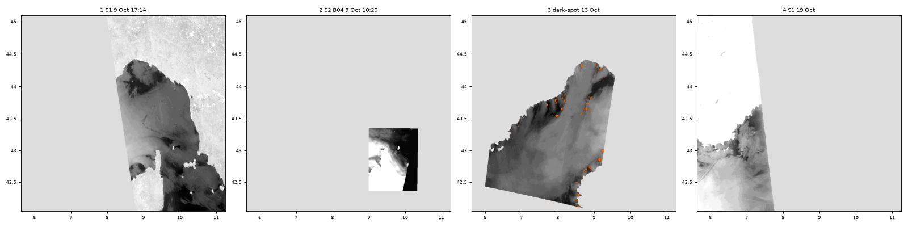
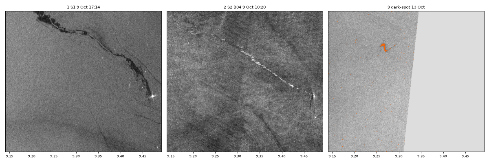

# Ulysse / CSL Virginia oil spill, October 2018

Studio project: <https://studio.mpc.ds.io/editor/exp-ulysse-csl-virginia-oil-spill-oct-2018-sentinel-1-radar>
(title "Exp - Ulysse CSL Virginia oil spill Oct 2018 Sentinel-1 radar").
Files: `studio_script.py` (the code pasted in Studio), `seed.js` (seeds the Studio editor with it),
`run_config.json` (the editor settings used for local tests).
To present it: [presenter notes](presenter-notes.md).

## The event

On 7 Oct 2018 at 07:02 local time (05:02 UTC) the ro-ro ferry *Ulysse* struck the container ship
*CSL Virginia*, at anchor about 28 km north of Cap Corse (BEAmer 2019). Bunker fuel leaked from the
*CSL Virginia*'s hull. The two ships stayed locked together until the evening of 11 Oct; the
*CSL Virginia* then stayed at the collision site until it left on 23 Oct. The fuel drifted north-west,
broke into strings and patches, and was carried south-west by the Ligurian Current; the first oil
beached near Saint-Tropez on 16 Oct (Pampelonne beach, Ramatuelle; Cedre).

*The four layers at map zoom 8, rendered on a local copy of the backend (identical to production).*

## How to read radar images of the sea

Sentinel-1 is a radar satellite: it sends microwave pulses and measures how much comes back. The
small (centimetre) waves that wind raises on the sea scatter part of the pulse back, so open sea looks
grey. Oil damps those small waves, so the sea under a slick is smoother and sends less back: a slick is
a **dark patch with sharp edges**. Ships and platforms are **bright dots**.

This only works at moderate wind, from about 1.5-3 m/s up to 6-10 m/s (Fingas & Brown 2018). Several
things look like oil (the "look-alikes"; Topouzelis 2008):

- calm water where there is little wind (broad, diffuse dark areas);
- wind shadows behind land;
- natural surface films, drawn into lines and spirals by eddies (Gade et al. 2013; Munk 2001).

One radar image cannot tell oil from a natural film, which is why dark features away from the ships are
labelled "oil possible" (Alpers et al. 2017 question detections that were not checked by aircraft or on
site). Below about -22 dB the radar can be at its instrument noise floor (about -30 to -22 dB,
Kellndorfer et al. 2022): there, darker grey means little or no measurable return, not "more oil".

## The four layers

### 1. 9 Oct 2018, 17:14 UTC: radar, the slick at its source (opens here)

- **What you see:** a dark line about 60 km long, running west-north-west from the two ships (bright dot
  at ~43.25N 9.48E) and curling north at its far end. The broad dark areas south-east of the ships and
  in the Gulf of Genoa are probably calm, low-wind water (look-alikes; ESA calls the first one calm water).
- **How it is made:** Sentinel-1A pass of 9 Oct 17:14 UTC (`sentinel-1-rtc`, VV polarisation,
  terrain-corrected backscatter on a 10 m grid). The 2 image slices of the pass are mosaicked, converted
  to decibels (10 log10) and shown in grey in 1 dB steps, -26 dB black to -6 dB white.
- **Method:** visual reading of dark, sharp-edged patches in C-band VV radar, with the wind window, the
  bright-ship signature and the look-alike criteria of Topouzelis (2008) and Fingas & Brown (2018).

### 2. 9 Oct 2018, 10:20 UTC: optical, the same slick 7 hours earlier

- **What you see:** zoomed in on the ships (map zoom 11 or more), a dashed bright streak about 20 km
  long running west-north-west from the ships, on the path the radar shows dark 7 hours later. At the
  opening zoom the layer is a white and dark-grey box: zoom in.

  

- **How it is made:** one Sentinel-2A image (`sentinel-2-l2a`, tile 32TNN, 9 Oct 10:20 UTC), red band
  B04 (665 nm, 10 m), grey from reflectance 0 (black) to 0.005 (white). Open sea is about 0.0016 and the
  streak about 0.006; land, cloud and hazy water are white. Only one tile is used, because the
  atmospheric correction (Sen2Cor) treats each tile on its own and over the sea neighbouring tiles differ
  by up to 8x, which leaves seams. Faint diagonal bands follow the Sentinel-2 detector footprints.
- **Method:** presence or absence of the slick from its contrast with the water around it, the standard
  optical use (Hu et al. 2021), and only where the radar already shows the slick, because visible data
  alone cannot identify oil at an unknown location (Fingas & Brown 2018). Oil can look brighter or darker
  than water depending on sun and view angles, oil type and thickness (Zhao et al. 2014), and sunglint
  contrast can reverse (Jackson & Alpers 2010). Sentinel-2 has been used to corroborate Sentinel-1 slicks
  (Rajendran et al. 2021) and to map oil (Kolokoussis & Karathanassi 2018). Sen2Cor red reflectance over
  water can be off by more than 100 % (Warren et al. 2019), hence one tile and relative values only. The
  brightness is not used to infer thickness or oil type.

### 3. 13 Oct 2018, 05:36 UTC: radar with automatic dark-spot detection

- **What you see:** six days on, sharp-edged dark fragments 60-80 km north-west of the ships
  (43.55-43.8N, 8.6-9.0E), probably the drifting slick, flagged **orange**. Orange along the Ligurian and
  west Corsican coasts is probably wind shadow (look-alike): a flag is a candidate, not oil.
- **How it is made:** Sentinel-1A pass of 13 Oct (only the slices over 42-47N). Land is masked first
  (GLOBE 30" land mask grown 1 km seaward, stored in the script as `LAND`). Each sea pixel is flagged
  when it is at least K = 3 dB darker than the mean of the sea pixels in the 31 x 31 map pixels around
  it; the grey radar image stays underneath. The backend computes each 256-pixel map tile on its own, so
  the window follows the zoom: ~14 km at zoom 8, ~7 km at zoom 9, ~3.5 km at zoom 10. Dark areas much
  wider than the window (low wind) are mostly not flagged; narrow ones are.
- **Method:** step 1 (dark-spot detection by an adaptive threshold) of the dark spot -> features ->
  oil-or-look-alike chain of Solberg et al. (1999, 2007); as reviewed by Topouzelis (2008), "the threshold
  is set k dB below the mean value of the moving window". Simplified here: one fixed window, no multiscale
  pyramid, no speckle filter, no clustering or minimum size, a mean of dB values, one fixed K. K = 3 dB is
  a display choice: the published methods adapt the threshold to sensor and wind (Solberg et al. 1999;
  Mera et al. 2012), and the 1.9 dB found best by Babagolimatikolaei (2025) was tuned on VV amplitude in
  the Persian Gulf, so it is not directly comparable.

### 4. 19 Oct 2018, 17:31 UTC: radar, fragments off the Var

- **What you see:** sharp-edged dark fragments 30-60 km off the Var (42.85-43.05N, 6.6-7.5E), three days
  after the first oil beached ("oil possible"). The broad, diffuse dark patches along the coast are
  probably low wind (look-alike), and thin curls further north are surface films (natural or oil) drawn
  out by eddies.
- **How it is made:** as layer 1, but with its own grey ramp, -30 dB black to -16 dB white, because this
  light-wind scene is 5-7 dB darker overall (median -22.2 dB, against -14.7 dB on 9 Oct). Much of it is
  near the radar noise floor, so its darkest greys are not quantitative.
- **Method:** as layer 1. Drift context: surface waters flowing north on both sides of Corsica join in
  the Gulf of Genoa to form the Ligurian (Northern) Current, which follows the coast of Provence (Millot
  1987); the drift of this spill was modelled by Liubartseva et al. (2020).

## Choices and limits

- Layers dropped from the first version: the 8 Oct (two passes), 14 Oct and 20 Oct radar images, which
  repeated what layers 1, 3 and 4 show.
- No wind data were checked (ERA5 on Planetary Computer is Zarr only, which the backend cannot read):
  every "low wind" or "wind shadow" reading comes from the shape and level of the backscatter.
- The 13 Oct fragments are linked to the Ulysse spill by position, sharp edges and timing; no dated
  official position for 13 Oct was found.
- `sentinel-1-rtc` is documented by Planetary Computer as needing an account to read; anonymous access
  works today. If that changes, layers 1, 3 and 4 stop rendering; layer 2 does not.
- Cold tiles at map zoom 6 can take 35-40 s (many radar slices per tile).

## Data

| Layer | Collection | Item(s) / time window (UTC) | Band |
|---|---|---|---|
| 1 | `sentinel-1-rtc` | S1A pass, 2018-10-09 17:09-17:19 | VV |
| 2 | `sentinel-2-l2a` | S2A, 2018-10-09 10:15-10:25, MGRS tile 32TNN | B04 |
| 3 | `sentinel-1-rtc` | S1A pass, 2018-10-13 05:35:40-05:36:30 | VV |
| 4 | `sentinel-1-rtc` | S1A pass, 2018-10-19 17:26-17:36 | VV |

## References

Event:
- BEAmer (2019), investigation report, <https://www.bea-mer.developpement-durable.gouv.fr/rapport-d-enquete-abordage-du-csl-virginia-par-l-a506.html>
- ESA, "Oil spill spread", <https://www.esa.int/ESA_Multimedia/Images/2018/10/Oil_spill_spread>
- Cedre, incident sheet, <https://cedre.fr/en/resources/incident-information-sheets/csl-virginia>
- Préfecture maritime de la Méditerranée, quoted by Corse Net Infos, 13 Oct 2018, <https://www.corsenetinfos.corsica/Collision-maritime-au-large-du-Cap-Corse-Quand-l-equipage-de-L-Ulysse-fait-le-buzz_a35919.html>
- Liubartseva et al. (2020), Mar. Pollut. Bull. 154, 111002, <https://doi.org/10.1016/j.marpolbul.2020.111002>

Method (every DOI checked on Crossref):
- Alpers, Holt & Zeng (2017), Remote Sens. Environ. 201, 133-147, <https://doi.org/10.1016/j.rse.2017.09.002>
- Babagolimatikolaei (2025), J. Ocean Eng. Sci. 10, 386-394, <https://doi.org/10.1016/j.joes.2022.05.029>
- Fingas & Brown (2018), Sensors 18, 91, <https://doi.org/10.3390/s18010091>
- Gade et al. (2013), Oceanography 26(2), 138-149, <https://doi.org/10.5670/oceanog.2013.39>
- Hu et al. (2021), J. Remote Sens. 2021, 9141902, <https://doi.org/10.34133/2021/9141902>
- Jackson & Alpers (2010), J. Geophys. Res. 115, C09019, <https://doi.org/10.1029/2009JC006037>
- Kellndorfer et al. (2022), Sci. Data 9, 73, <https://doi.org/10.1038/s41597-022-01189-6>
- Kolokoussis & Karathanassi (2018), J. Mar. Sci. Eng. 6, 4, <https://doi.org/10.3390/jmse6010004>
- Mera et al. (2012), Mar. Pollut. Bull. 64, 2090-2096, <https://doi.org/10.1016/j.marpolbul.2012.07.018>
- Millot (1987), Oceanol. Acta 10, 143-149 (no DOI), <https://archimer.ifremer.fr/doc/00108/21915/19505.pdf>
- Munk (2001), Sci. Mar. 65(S2), 193-198, <https://doi.org/10.3989/scimar.2001.65s2193>
- Rajendran et al. (2021), Environ. Pollut. 274, 116618, <https://doi.org/10.1016/j.envpol.2021.116618>
- Solberg et al. (1999), IEEE TGRS 37, 1916-1924, <https://doi.org/10.1109/36.774704>
- Solberg, Brekke & Husøy (2007), IEEE TGRS 45, 746-755, <https://doi.org/10.1109/TGRS.2006.887019>
- Topouzelis (2008), Sensors 8, 6642-6659, <https://doi.org/10.3390/s8106642>
- Warren et al. (2019), Remote Sens. Environ. 225, 267-289, <https://doi.org/10.1016/j.rse.2019.03.018>
- Zhao et al. (2014), Opt. Express 22, 13755, <https://doi.org/10.1364/OE.22.013755>

## Credits

Contains modified Copernicus Sentinel data 2018; RTC processing by Catalyst (CC BY 4.0), via Microsoft
Planetary Computer. Land mask: GLOBE (NOAA NGDC), via the global-land-mask package.
