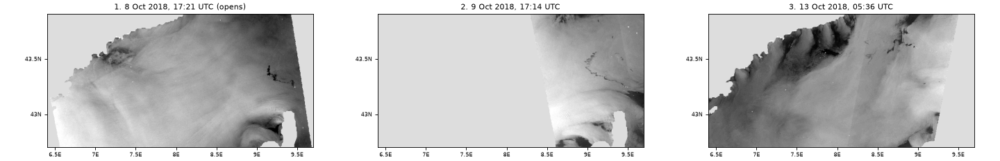
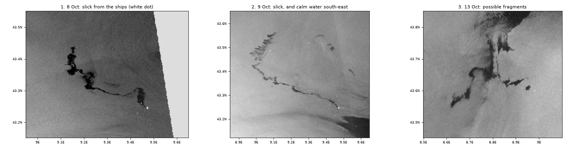
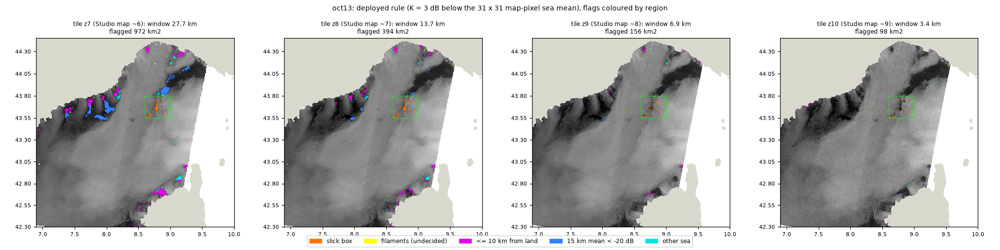

# Ulysse / CSL Virginia oil spill, October 2018

Studio project: <https://studio.mpc.ds.io/editor/exp-ulysse-csl-virginia-oil-spill-oct-2018-sentinel-1-radar>
(title "Exp - Ulysse CSL Virginia oil spill Oct 2018 Sentinel-1 radar"; opens on layer 1).
Files: `studio_script.py` (the code pasted in Studio), `seed.js` (seeds the Studio editor with it),
`run_config.json` (the editor settings used for local tests).

> **Presenting this scenario?** Follow the [presenter notes](presenter-notes.md): the layer to open
> with, then what to show and what to say at each step (2-3 minutes).

## The event

On 7 Oct 2018 at 05:02 UTC (07:02 local time) the ro-ro ferry *Ulysse* struck the container ship
*CSL Virginia*, at anchor about 28 km north of Cap Corse (43.248N 9.478E; BEAmer 2019). Bunker fuel leaked
from the *CSL Virginia*'s hull. The two ships stayed locked together until the evening of 11 Oct.

What the official and satellite records say, day by day (times UTC):
- **8 Oct.** At dawn a broken ribbon more than 20 km long (French Navy aircraft; ESA about 20 km on the
  05:28 radar image; EMSA 22 km). In the evening, on the 17:21 radar image, "about 35 km" (ESA).
- **9 Oct.** In the morning, aircraft counted 25 km of oil in 7 sections. On the 17:14 radar image ESA
  measured about 60 km; EMSA's CleanSeaNet brochure gives 50 km "at its longest point". The large dark patch
  south-east of the ships on that image is calm water (ESA).
- **10-12 Oct.** Aircraft followed strips of about 25 km drifting north-west, then further north towards the
  Ligurian coast. No Sentinel-1 image covered the slick on 10-11 Oct.
- **13 Oct.** The Préfecture maritime reported that the oil moved north and then south-west with the
  Ligurian Current, breaking into fragments and tarballs; it gave no position.
- **From 14 Oct.** No more significant thick patches at sea, only tarballs; the east wind strengthened. There
  was no Sentinel-1 pass at all on 16-17 Oct.
- **From 16 Oct.** Oil reached the Var beaches, first at Pampelonne (Ramatuelle). Cedre and Météo-France link
  it to this spill; at the time the Var prefecture could not establish the origin with certainty, and no
  published chemical match was found.

*The three layers at tile zoom 8 (about Studio map zoom 7), rendered from the Studio code on a local copy of
the backend; light grey = land (transparent in Studio) or no data.*

## How to read radar images of the sea

Sentinel-1 is a radar satellite: it sends microwave pulses and measures how much comes back. The small
(centimetre) waves that wind raises on the sea scatter part of the pulse back, so open sea looks grey. Oil
damps those small waves, so the sea under a slick is smoother and sends less back: a slick is a **dark patch
with sharp edges**. Ships are **bright dots**. Radar works through cloud and at night: layers 1 and 2 were
taken 23-28 minutes after sunset.

This only works at moderate wind, from about 1.5-3 m/s up to 6-10 m/s (Fingas & Brown 2018; Topouzelis 2008).
Several things look like oil (the "look-alikes"; Topouzelis 2008):
- calm water where there is little wind (broad, diffuse dark areas);
- sea sheltered from the wind by land;
- natural surface films, drawn into lines and spirals by eddies (Gade et al. 2013).

One radar image cannot tell oil from a natural film (Alpers et al. 2017 question the high success rates
claimed for single-polarisation radar detection, because its training images were rarely checked by aircraft
or on site). **All three layers share one grey scale** (-26 dB black to -10 dB white), so a brighter sea means
a stronger wind, which is the main clue for telling oil from low-wind look-alikes. Straight lines across the
sea are instrument seams (probably sub-swath boundaries).

## The three layers

All three: Sentinel-1 radiometrically terrain-corrected backscatter (`sentinel-1-rtc`, VV, 10 m grid), all
image slices of the pass mosaicked, converted to decibels (10 log10), land made transparent (GLOBE land mask
grown 1 km seaward), grey in 0.5 dB steps from -26 dB (black) to -10 dB (white). Wind is ERA5 10 m wind at
the oil (a 0.25° model, not local wind).

*What to look at in each layer, at tile zoom 9 (local render of the Studio code).*

### 1. 8 Oct 2018, 17:21 UTC: the slick at its source (opens here)

- **What you see:** a dark slick about 35 km long leaving the two ships (white dot at ~43.25N 9.48E) towards
  the north-west, ending near 43.44N 9.14E. ESA measured this exact image at about 35 km; the 10 Oct aircraft
  strips lie along it.
- **Pass:** Sentinel-1B, relative orbit 88 (ascending), 3 slices. Wind 3.1 m/s, at the low edge of the
  detectable range, so the image has its own look-alikes: the lee of Corsica (9.0-9.4E, 42.8-43.0N) and a
  coastal low-wind swirl (7.0-7.4E, 43.45-43.57N).
- **Why this pass:** the boldest view of the slick on any Sentinel-1 image. The 05:27 image of the same morning
  is the official first image (about 20 km) but the slick is too thin to read at the opening zoom.

### 2. 9 Oct 2018, 17:14 UTC: 24 hours later

- **What you see:** a dark line 50-60 km long out to about 8.97E 43.43N, curling north at its end (to about
  9.1E 43.56-43.58N). The broad dark area south-east of the ships (9.5-9.6E, 43.15-43.22N) is calm water, as
  ESA described it: the look-alike lesson.
- **Pass:** Sentinel-1A, relative orbit 15 (ascending). Wind 3.2 m/s. With the shared grey scale the slick
  is fainter than layer 1 (16 grey levels of contrast against the sea at tile zoom 8, against 32 for layer 1).
- **Why this pass:** together with layer 1 it shows the growth in 24 hours, as ESA published it. The morning
  aircraft count (25 km in 7 sections) is shorter than the radar line, which also includes thin sheen.

### 3. 13 Oct 2018, 05:36 UTC: possible drifting fragments

- **What you see:** sharp-edged dark fragments 60-80 km north-west of the ships (8.62-8.97E, 43.55-43.78N),
  possibly part of the drifting oil. Look first at the compact south-west patch (about 16 km²) and the east
  patch (about 4 km²). The largest dark object, a 54 km² north-south mass at 43.63-43.76N 8.70-8.83E, is the
  most ambiguous: its straight east edge runs roughly parallel to the wind, and its northern fingers merge into
  the Gulf of Genoa low-wind zone. Dark areas near the coasts are sheltered from the wind; radar cannot tell
  whether oil is inside them.
- **Pass:** Sentinel-1A, relative orbit 66 (descending), 4 slices; the ships are outside the swath. Wind
  4.4 m/s.
- **Why "possibly":** no source gives an oil position for 13 Oct. The fragments lie inside the drift corridor
  forecast by Météo-France's MOTHY model (Daniel et al. 2021, Fig. 2), but the leading oil was probably closer
  to the coast, in sheltered low-wind sea where radar cannot separate it (along that corridor west of 8.4E, 17 %
  of sea pixels are below -22 dB).

## What was left out, and why

- **Automatic dark-spot detection** (the 13 Oct orange flags of the previous version). Re-implemented exactly
  (2,490 of 2,490 orange pixels match the backend) and scored against the probable oil: at the opening view
  only 13 % of the orange fell on it and 58 % lay within 10 km of the coast; the flags also changed with zoom,
  because the 31-pixel window spans 27.7 km at tile zoom 7 but 3.4 km at zoom 10 (the orange area fell from
  972 km² at zoom 7 to 98 km² at zoom 10), so zooming in unflagged most of the largest fragment. No per-tile
  variant worked on all three passes. In the literature this adaptive threshold is only step 1 of a three-step
  chain (dark spots, then features, then oil or look-alike; Solberg et al. 1999, 2007), its output is mostly
  look-alikes, and it is meant for trained operators. Automatic detection helps, but a person still has to judge
  every candidate.

  

  *The previous 13 Oct detection layer (orange) at tile zooms 7 to 10: the flags change with zoom.*
- **Sentinel-2, 9 Oct 10:20.** The slick shows as a thin bright streak in the red band, but only from map zoom
  11 near the ships; at the opening zoom the layer was a white and dark box. It confirms what the radar shows
  and adds nothing new:

  

  *Previous version, 9 Oct around the ships at zoom 11: radar, Sentinel-2 red band and the detection flags.*
- **19 Oct off the Var.** Wind 1.3-3.0 m/s, 57 % of the Var area below -22 dB, and the "fragments" at about
  -27 dB, at the instrument noise floor; from 14 Oct the officials reported only tarballs. The morning pass of
  the same day (7.0 m/s) shows only faint, unconfirmed lines 10-20 km west of the evening ones, so the pair does
  not support itself.
- **14 Oct.** A thin trail attached to the *CSL Virginia* (43.25-43.35N) shows the ship still leaking (Cedre
  reports new leaks in rough seas), but only when zoomed in to tile zoom 10; elsewhere the wind was 8.7-10.9 m/s, above the
  range where oil shows.
- **12, 14 and 18 Oct passes** off the Var and along the Ligurian Current: winds of 8.7-11.1 m/s.

## Choices and limits

- **Where the record stops.** Radar saw the slick clearly on 8 and 9 Oct and glimpsed possible fragments on
  13 Oct; aircraft did the daily tracking. No Sentinel-1 image shows the oil arriving on the Var coast.
- **Wind** was not used to make the layers; ERA5 values above are a 0.25° model, too coarse for single calm
  patches, so "low wind" and "sheltered" readings come from the shape and level of the backscatter.
- **The opening zoom depends on window width.** Below about 525 px of map width Studio opens at tile zoom 7,
  where the 9 Oct slick has no pixel below -21 dB; widen the window or zoom in one step.
- **First views are slow** (local tiles took 0.1-10 s; land-only tiles are the slowest, because the radar is
  read before it is masked).
- `sentinel-1-rtc` is documented by Planetary Computer as needing an account to read; anonymous access works
  today (21 Oct 2026). If that changes, the layers stop rendering.

## Data

| Layer | Collection | Pass (UTC time window) | Band |
|---|---|---|---|
| 1 | `sentinel-1-rtc` | S1B, relative orbit 88, 2018-10-08 17:20-17:24 | VV |
| 2 | `sentinel-1-rtc` | S1A, relative orbit 15, 2018-10-09 17:09-17:19 | VV |
| 3 | `sentinel-1-rtc` | S1A, relative orbit 66, 2018-10-13 05:35:40-05:36:30 | VV |

## References

Event:
- BEAmer (2019), investigation report, <https://web.archive.org/web/20201203140744id_/http://www.bea-mer.developpement-durable.gouv.fr/IMG/pdf/beamer-fr_csl_virginia_-_ulysse__fr-en__2018.pdf>
- ESA, "Oil spill spread", <https://web.archive.org/web/20191211035215/https://www.esa.int/ESA_Multimedia/Images/2018/10/Oil_spill_spread>
- EMSA CleanSeaNet brochure (2019), p. 6, <https://www.emsa.europa.eu/recently-published/download/5911/3771/23.html>
- Préfecture maritime de la Méditerranée, press releases on the collision, <https://www.premar-mediterranee.gouv.fr/communiques-presse/collision-entre-un-navire-roulier-et-un-porte-conteneurs-environ-28-km-au-nord-du-cap-corse>
- Cedre, incident sheet, <https://cedre.fr/en/resources/incident-information-sheets/csl-virginia>
- Daniel et al. (2021), Int. Oil Spill Conf. Proc. 2021, 1141410, <https://doi.org/10.7901/2169-3358-2021.1.1141410>
- Liubartseva et al. (2020), Mar. Pollut. Bull. 154, 111002, <https://doi.org/10.1016/j.marpolbul.2020.111002>

Method (every DOI checked on Crossref):
- Alpers, Holt & Zeng (2017), Remote Sens. Environ. 201, 133-147, <https://doi.org/10.1016/j.rse.2017.09.002>
- Fingas & Brown (2018), Sensors 18, 91, <https://doi.org/10.3390/s18010091>
- Gade et al. (2013), Oceanography 26(2), 138-149, <https://doi.org/10.5670/oceanog.2013.39>
- Hersbach et al. (2020), Q. J. R. Meteorol. Soc. 146, 1999-2049, <https://doi.org/10.1002/qj.3803>
- Solberg et al. (1999), IEEE TGRS 37, 1916-1924, <https://doi.org/10.1109/36.774704>
- Solberg, Brekke & Husøy (2007), IEEE TGRS 45, 746-755, <https://doi.org/10.1109/TGRS.2006.887019>
- Topouzelis (2008), Sensors 8, 6642-6659, <https://doi.org/10.3390/s8106642>

## History

- v1-v3 (21 Oct 2026): 7, then 4 layers (radar 9, 13 and 19 Oct, Sentinel-2 9 Oct), with an automatic
  dark-spot layer on 13 Oct.
- v4 (21 Oct 2026): after a re-review of the scenes and the detection (scene inventory, official records,
  detection scoring, two skeptics), three plain radar layers on one grey scale; the detection layer, Sentinel-2
  and 19 Oct dropped; 8 Oct evening added; land mask cropped to the passes (15 KB instead of 22 KB).
  Checked on a local copy of the backend (titiler-openeo c9b6ee3) on 33 tiles at tile zooms 7-10 for each
  layer: 81 tiles HTTP 200, 18 HTTP 404 "no data" (outside a pass), none failed; at least 97 % of the opaque
  pixels identical to a numpy emulation of the grey scale; land transparent; the 9 Oct slick 23 grey levels
  darker than the surrounding sea at tile zooms 7-8 and 31 at zoom 9. Not yet rendered in production.

## Credits

Contains modified Copernicus Sentinel data 2018; RTC processing by Catalyst (CC BY 4.0), via Microsoft
Planetary Computer. Land mask: GLOBE (NOAA NGDC), via the global-land-mask package.
